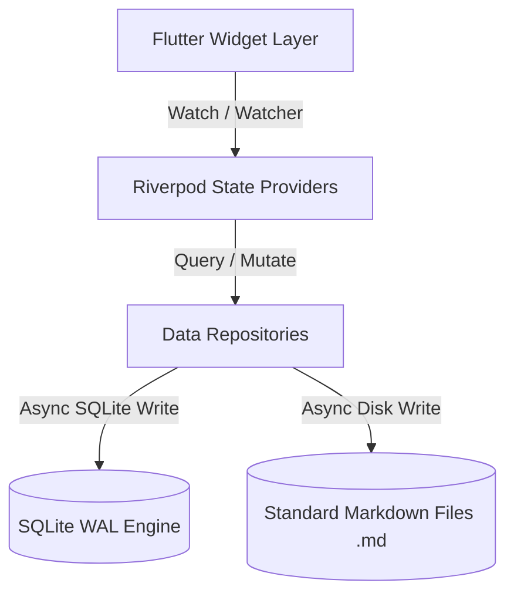

# Prism

*An elegant, private, offline-first personal workspace and relational markdown journal.*

Prism is built to be a premium, secure, and quiet space for your thoughts. Unlike traditional linear note-taking apps, Prism allows you to connect ideas together using standard double-bracket `[[wikilinks]]`, forming a dynamic, force-directed graph of your personal notebook.

---

## ── Core Philosophy & Pillars ─────────────────────────────────

1. **Absolute Local Privacy**: All notes reside strictly on your physical device as standard Markdown files (`.md`).
2. **Relational Thinking**: Seamlessly link thoughts together. Backlink indexing and "ghost placeholder" notes help capture thoughts before they fade.
3. **High-Fidelity Aesthetics**: Premium, harmonized color systems tailored for writing—*Midnight OLED*, *Clean Paper*, and *Warm Sepia* editorial serif theme.
4. **Tactile UX Animations**: Highly responsive bouncy micro-interactions and spring-based scales for button presses and navigation transitions.

---

## ── Technical Architecture & Infrastructure ────────────────────

Prism utilizes a robust, modern local-first architectural engine:

* **State Management**: Orchestrated entirely via **Riverpod (v2)**. Dynamic data updates are reactively synced across providers through centralized version increments (`notesVersionProvider` and `foldersVersionProvider`).
* **Storage Engine**: Integrated **SQLite (`sqflite`)** with **WAL (Write-Ahead Logging)** mode enabled, reducing file lock conflicts and providing fast, asynchronous read/write speeds.
* **Full-Text Search (FTS4)**: Powered by a virtual SQLite FTS4 table using a Porter tokenizer. Enables instantaneous full-text searches.
* **Navigation & Routing**: Declarative, type-safe routes powered by **GoRouter**.



---

## ── Modular Codebase Tour ──────────────────────────────────────

The application is structured following clean, feature-first modular architecture principles:

```text
lib/
├── core/
│   ├── database/     # SQLite configuration, WAL activation, and sync scanners
│   ├── router/       # Type-safe GoRouter setup
│   ├── services/     # Cross-cutting systems (Vault switcher)
│   ├── theme/        # Global typography, color schemes, and app themes
│   └── utils/        # Extractor parser helpers (slugs, tags, wikilinks)
│
├── features/
│   ├── editor/       # Markdown editing screen, conflict mergers, wikilink suggestions
│   ├── folders/      # Virtual folder categorization and mapping
│   ├── graph/        # Force-directed dynamic note mapping
│   ├── journal/      # Calendar reflection notes and daily templates
│   ├── notes/        # Debounced note listings, shimmers, and repositories
│   ├── onboarding/   # Sandbox storage setup flows and onboarding slides
│   └── settings/     # Storage location swappers and theme configs
│
├── shared/
│   ├── design_system/# Centralized Color, Spacing, Typography tokens, and animated buttons
│   └── widgets/      # Satisfying haptic TactileWrappers and shared banners
```

---

## ── Setup & Getting Started ───────────────────────────────────

### Prerequisites
- [Flutter SDK](https://docs.flutter.dev/get-started/install) (3.11+ recommended)
- Android/iOS emulator or physical device

### 1. Initialize and Resolve Dependencies
Clean up and fetch the streamlined dependencies from pubspec:
```bash
flutter clean
flutter pub get
```

### 2. Run Code Generation
Prism uses `build_runner` to generate providers and serialization maps:
```bash
flutter pub run build_runner build --delete-conflicting-outputs
```

### 3. Run Locally
Execute the app on your default connected device:
```bash
flutter run
```

---

## ── Verification & Test Suites ────────────────────────────────

Verify system stability using Prism's clean compilation and high-coverage test suites:

### Run Static Analysis
Ensure that code matches our zero-warning clean compilation baseline:
```bash
flutter analyze
```

### Run Automated Tests
Execute both widget mounting tests and the exhaustive utility test suites:
```bash
flutter test
```

---

## ── Contribution & Coding Standards ───────────────────────────

To maintain code security, speed, and visual premium feel:

1. **Main-Thread Integrity**: Never use blocking synchronous filesystem APIs (`existsSync`, `listSync`, `readAsStringSync`, `deleteSync`) inside application logic. Always prefer the non-blocking asynchronous streaming APIs.
2. **Defensive SQL Parameter Binding**: Always parameterize SQLite queries. Never interpolate variables directly into SQL statements.
3. **Search Sanitization**: All FTS4 queries must pass through the `sanitizeFtsQuery` filter to strip FTS operators and prevent DB parser crashes.
4. **Vault Safety**: Vault names must be matched against `^[a-zA-Z0-9 _\-]+$` to prevent directory traversal attacks or illegal OS characters.
5. **Design System Adherence**: Always retrieve colors, typography, spacing, and button styles using the centralized static extensions inside `lib/shared/design_system/`.
