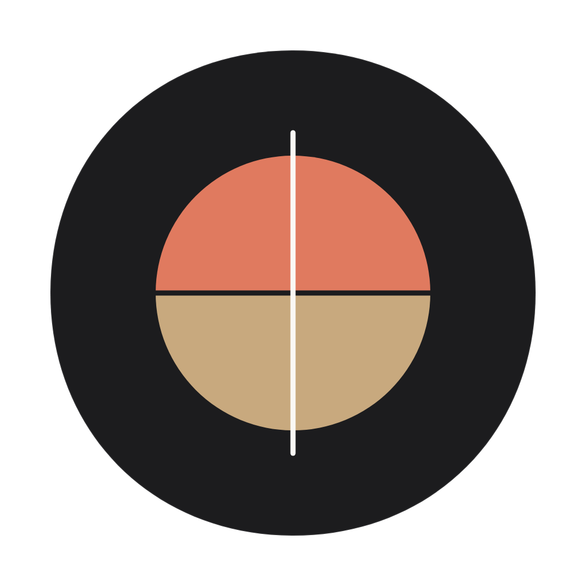

<div align="center">
  
  <h1>Prism</h1>
  <p>A connected markdown workspace and relational journal with an interactive graph view.</p>

  <p>
    <a href="https://flutter.dev"></a>
    <a href="https://dart.dev"></a>
    <a href="https://sqlite.org"></a>
    <a href="LICENSE"></a>
  </p>
</div>

---

## Features

### Markdown Editor & Bidirectional Linking
- **Live Markdown Formatting**: Formatting toolbar supporting headings, bold, italics, strikethrough, blockquotes, code blocks, lists, and checklists.
- **Wikilinks & Backlinks**: Connect notes using `[[wikilinks]]` with auto-complete suggestions. Automatically indexes incoming and outgoing references for every note.
- **Tagging & Collapsible Headings**: Inline `#tag` indexing and collapsible markdown headings for document navigation.
- **Custom Editor Macros**: Create custom snippet shortcuts on the toolbar with dynamic placeholder expansions (e.g., timestamps, boilerplate headers).
- **Conflict Resolution**: Side-by-side visual diff comparison to merge external file modifications and resolve sync collisions.
- **Bracket & Syntax Helpers**: Automatic bracket/quote pairing and smart markdown formatting utilities.

### Voice Notes & Media Management
- **Integrated Voice Recorder**: Record audio directly into notes with live waveform generation.
- **Inline Waveform Player**: Embedded audio player with interactive waveform scrubbing and playback speed controls.
- **Timestamped Audio Bookmarks**: Place markers at specific timestamps in voice recordings, add textual notes to individual bookmarks, and jump directly to key points during playback.
- **Attachments Manager**: Dedicated screen to preview, filter, search, and clean up unreferenced audio and image attachments across your vault.

### Interactive Knowledge Graph
- **Force-Directed Graph**: 2D canvas visualization showing how notes and tags connect across your notebook.
- **Physics & Navigation**: Adjustable repulsion and link force physics, pan/zoom canvas, node dragging, and node pinning.
- **Neighborhood Focus & Tag Filtering**: Highlight direct connections and filter graph nodes by specific `#tags` or folders.
- **Chronological Graph Replay**: Animate the evolution of your notebook over time in the order notes were created.

### Daily Journal & Habit Tracking
- **Dedicated Daily Journal**: Dedicated journal tab with single-tap creation for today's reflection entry.
- **Streak & Activity Grid**: GitHub-style yearly contribution heatmap displaying journaling consistency, streak counts, and activity stats.
- **Custom Templates**: Pre-fill daily notes or standard entries with reusable markdown templates and dynamic date/time macros.

### Android System Integration
- **Home Screen Widgets**: Quick Capture widget to start new notes instantly, and a Streak Widget to track daily habit consistency from your home screen.
- **Share Sheet Web Clipper**: Share text, links, and articles from any browser or external app directly into your Prism Inbox without interrupting your workflow.

### Search, Sync & Vault Management
- **Instant Full-Text Search**: Fast SQLite FTS4 search with query sanitization, matching title and body text snippets.
- **Multi-Vault Support**: Create and switch between isolated vaults with independent databases and directories.
- **Virtual Folders**: Organize notes into virtual folders without altering the underlying markdown file structure.
- **Encrypted Cloud Sync**: Optional two-way sync with Google Drive featuring client-side AES encryption.
- **Vault Export**: Export vaults to portable ZIP archives, structured JSON (with pre-resolved backlinks and tags), or formatted PDFs.

### Personalization & Themes
- **Color Themes**: Harmonized dark and light themes, including Midnight OLED, Clean Paper, and Warm Sepia.
- **Typography Controls**: Choose between modern sans-serif, editorial serif, or monospace font families (Inter, Merriweather, Lora, Roboto Mono) with adjustable font size and line height.

---

## Tech Stack

| Layer | Technology |
| :--- | :--- |
| **Framework** | [Flutter](https://flutter.dev) (Dart 3.4+) |
| **State Management** | [Riverpod (v2)](https://riverpod.dev) with Code Generation |
| **Database & Search** | [SQLite (`sqflite`)](https://pub.dev/packages/sqflite) with WAL mode and FTS4 |
| **Routing** | [GoRouter](https://pub.dev/packages/go_router) |
| **Design System** | Custom tactile tokens (Typography, Palette, Springs & Haptics) |

---

## Getting Started

### Prerequisites

- [Flutter SDK](https://docs.flutter.dev/get-started/install) (3.22+)
- Android Studio or VS Code with Flutter extension
- Android/iOS emulator or connected physical device

### Installation & Run

1. **Clone the repository**:
   ```bash
   git clone https://github.com/Codymwon/Meridian.git
   cd Meridian
   ```

2. **Install dependencies**:
   ```bash
   flutter pub get
   ```

3. **Run code generation**:
   ```bash
   dart run build_runner build --delete-conflicting-outputs
   ```

4. **Launch the app**:
   ```bash
   flutter run
   ```

---

## Testing & Quality

Run all automated unit and widget tests:
```bash
flutter test
```

Run static code analysis:
```bash
flutter analyze
```

---

## Project Structure

<details>
<summary>Click to expand project directory layout</summary>

```text
lib/
├── core/             # Database, router, theme, and shared services
├── features/
│   ├── editor/       # Markdown editor, live preview, and audio bookmarks
│   ├── folders/      # Virtual folder categorization
│   ├── graph/        # Force-directed graph view and physics engine
│   ├── journal/      # Daily journaling and streak grid
│   ├── notes/        # Note listings, parsing, and repositories
│   ├── onboarding/   # Setup wizard and storage initialization
│   ├── settings/     # App preferences, cloud sync, and vault export
│   └── subscription/ # Pro features and paywall integration
└── shared/           # Design system tokens and reusable UI widgets
```

</details>

---

## License

This project is licensed under the MIT License.

