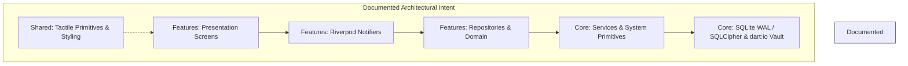

# Architectural Audit Report: Context, ADRs & Architectural Intent

**Target:** Small Giant Studio — Prism (Flutter Android Workspace)  
**Auditor:** Subagent 1: Context, ADRs & Architectural Intent  
**Date:** 2026-10-23  
**Status:** Complete & Fully Referenced  

---

## 1. Executive Summary

* **State Machine & Dynamic Island Fragmentation (ADR 0013 Drift):** While ADR 0013 declared a "Universal Fusion" and a "Unified State Machine" governed by a single `dynamicIslandControllerProvider` and a single `AnimationController` in `AppShell`, the actual implementation in [`lib/shared/widgets/app_shell.dart:L50-L120`](file:///home/aadith/development/active-projects/Prism/lib/shared/widgets/app_shell.dart#L50-L120) retains **five separate `AnimationController` instances** (`_expansionController`, `_timerController`, `_menuExpansionController`, `_quickCaptureController`, `_vaultHubController`) and concurrently watches four legacy notifiers alongside the unified controller ([`lib/shared/widgets/app_shell.dart:L944, L988-L990`](file:///home/aadith/development/active-projects/Prism/lib/shared/widgets/app_shell.dart#L944)).
* **Architectural Memory Ignored by Git:** The entire architectural foundation—including all ADRs (`docs/adr/`), domain specs ([`docs/CONTEXT.md`](file:///home/aadith/development/active-projects/Prism/docs/CONTEXT.md)), QA test matrices ([`docs/FEATURE_TESTING.md`](file:///home/aadith/development/active-projects/Prism/docs/FEATURE_TESTING.md)), and State Management kanban boards ([`docs/PROJECT_BOARD.md`](file:///home/aadith/development/active-projects/Prism/docs/PROJECT_BOARD.md))—is explicitly excluded from version control via [`.gitignore:L58-L59`](file:///home/aadith/development/active-projects/Prism/.gitignore#L58-L59), creating complete context loss for any fresh clone, CI runner, or collaborator. Furthermore, an untracked, stale duplicate exists at root ([`CONTEXT.md`](file:///home/aadith/development/active-projects/Prism/CONTEXT.md)).
* **Severe Layer & Boundary Inversions:** The documented "Feature-First / Layered Architecture" ([`docs/APP_OVERVIEW.md:L15-L29`](file:///home/aadith/development/active-projects/Prism/docs/APP_OVERVIEW.md#L15-L29)) is routinely violated. Core system services directly import concrete feature models and repositories ([`lib/core/services/note_ingestion_service.dart:L5-L10`](file:///home/aadith/development/active-projects/Prism/lib/core/services/note_ingestion_service.dart#L5-L10), [`lib/core/services/vault_export_service.dart:L14-L15`](file:///home/aadith/development/active-projects/Prism/lib/core/services/vault_export_service.dart#L14-L15)), core services import feature presentation layers ([`lib/core/services/data_deletion_service.dart:L13`](file:///home/aadith/development/active-projects/Prism/lib/core/services/data_deletion_service.dart#L13)), and `lib/shared/` contains complex domain widgets directly coupled to feature internals ([`lib/shared/widgets/quick_capture_bottom_sheet.dart:L11-L16`](file:///home/aadith/development/active-projects/Prism/lib/shared/widgets/quick_capture_bottom_sheet.dart#L11-L16)).
* **Halted Riverpod Generator Migration (ADR 0001 Stagnation):** Despite ADR 0001 accepting a migration to Riverpod Generator and Freezed, over 40 providers remain on legacy Riverpod syntax (`StateNotifierProvider`, `StateProvider`, `Provider`, `FutureProvider.autoDispose`). Legacy `StateProvider`s are even defined directly inside screen presentation files ([`lib/features/journal/presentation/screens/journal_screen.dart:L19-L20`](file:///home/aadith/development/active-projects/Prism/lib/features/journal/presentation/screens/journal_screen.dart#L19-L20)), while `build.yaml:L20-L27` needlessly executes the rejected `json_serializable` builder across the entire codebase on every build.
* **FTS5 "Full-Text" Search Falsehood:** Both [`README.md:L50`](file:///home/aadith/development/active-projects/Prism/README.md#L50) and [`docs/APP_OVERVIEW.md:L32`](file:///home/aadith/development/active-projects/Prism/docs/APP_OVERVIEW.md#L32) claim "Instant Full-Text Search" matching title and body text snippets. In reality, the database virtual table `notes_fts` only indexes `id` and `title` ([`lib/core/database/database_helper.dart:L239-L244`](file:///home/aadith/development/active-projects/Prism/lib/core/database/database_helper.dart#L239-L244)), and `NoteRepository.searchNotes()` queries only `f.title MATCH ?` ([`lib/features/notes/data/note_repository.dart:L169`](file:///home/aadith/development/active-projects/Prism/lib/features/notes/data/note_repository.dart#L169)). Note content is never indexed or searched.

---

## 2. Current Architecture Map: Documented Intent vs. Physical Structure

### 2.1 The Documented Ideal (Layered Feature-First)

According to [`docs/PRISM_ARCHITECTURE.md:L27-L51`](file:///home/aadith/development/active-projects/Prism/docs/PRISM_ARCHITECTURE.md#L27-L51) and [`docs/APP_OVERVIEW.md:L15-L29`](file:///home/aadith/development/active-projects/Prism/docs/APP_OVERVIEW.md#L15-L29), Prism is organized into three strictly bounded architectural tiers:
1. `core/`: Low-level system primitives (database indexer, routing, platform adapters, encryption, theme definitions) with zero dependencies on specific feature business logic.
2. `shared/`: Generic, domain-agnostic UI tokens, tactile feedback wrappers, and primitive visual styling widgets.
3. `features/`: Autonomous, feature-sliced domain directories (`editor`, `folders`, `graph`, `journal`, `notes`, `onboarding`, `settings`, `subscription`) communicating unidirectionally through Riverpod providers.



### 2.2 The Physical Reality (Inverted Dependencies & Leaky Abstractions)

In reality, dependencies flow backward and sideways across architectural boundaries. Core services depend on concrete feature data implementations, `shared/` hosts bloated domain decks, and features form circular cross-imports.

```mermaid
graph TD
    subgraph Physical Dependency Reality
        AppShell["shared/widgets/app_shell.dart<br/>(Watches 5 Controllers + 5 Notifiers)"]
        
        subgraph Core Layer Violations
            CoreIngestion["core/services/note_ingestion_service.dart"]
            CoreExport["core/services/vault_export_service.dart"]
            CoreDeletion["core/services/data_deletion_service.dart"]
            CorePlatform["core/platform/widget_helper.dart"]
        end
        
        subgraph Shared Layer Violations
            SharedQuickCapture["shared/widgets/quick_capture_bottom_sheet.dart"]
            SharedVaultHub["shared/widgets/vault_hub.dart"]
            SharedCards["shared/design_system/cards.dart"]
        end
        
        subgraph Features Cross-Coupling
            FeatNotes["features/notes/ (data & presentation)"]
            FeatFolders["features/folders/ (data & presentation)"]
            FeatSettings["features/settings/ (presentation)"]
            FeatSub["features/subscription/ (presentation & data)"]
            FeatJournal["features/journal/ (presentation)"]
            FeatEditor["features/editor/ (presentation & data)"]
        end
        
        %% Leaks from Core down into Features
        CoreIngestion -->|imports| FeatNotes
        CoreIngestion -->|imports| FeatFolders
        CoreExport -->|imports| FeatNotes
        CoreExport -->|imports| FeatFolders
        CoreDeletion -->|imports| FeatSub
        CorePlatform -->|imports| FeatNotes
        
        %% Leaks from Shared down into Features
        SharedQuickCapture -->|imports| FeatEditor
        SharedQuickCapture -->|imports| FeatFolders
        SharedQuickCapture -->|imports| FeatNotes
        SharedVaultHub -->|imports| FeatNotes
        SharedVaultHub -->|imports| FeatFolders
        SharedCards -->|imports| FeatNotes
        AppShell -->|imports| FeatNotes
        AppShell -->|imports| FeatFolders
        
        %% Circular & Cross-Feature Coupling
        FeatNotes <-->|CIRCULAR COUPLING (16 imports)| FeatFolders
        FeatSettings -->|imports (9 files)| FeatSub
        FeatJournal -->|imports| FeatNotes
        FeatJournal -->|imports| FeatEditor
        FeatSettings -->|imports| FeatEditor
    end
```

### 2.3 Physical Directory & Architectural Layer Breakdown

| Directory Path | Documented Responsibility | Actual Responsibility & Boundary Violations |
| :--- | :--- | :--- |
| [`lib/core/services/`](file:///home/aadith/development/active-projects/Prism/lib/core/services/) | System-level services (Sync, Encryption, Analytics) | **Layer Inversion:** `note_ingestion_service.dart:L5-L10` imports 5 concrete feature files (`Note`, `VaultStorage`, `VaultServiceImpl`, `MarkdownContentParser`, `SqliteMetadataIndexer`, `VirtualFolderSyncHelper`). `vault_export_service.dart:L14-L15` imports feature repositories (`NoteRepository`, `FolderRepository`). `data_deletion_service.dart:L13` imports presentation providers (`SubscriptionProviders`). |
| [`lib/core/platform/`](file:///home/aadith/development/active-projects/Prism/lib/core/platform/) | Android widget & platform helpers | **Layer Inversion:** `widget_helper.dart:L6-L7` directly imports `NoteRepository` and `notes_providers.dart` from `features/notes/`. |
| [`lib/shared/`](file:///home/aadith/development/active-projects/Prism/lib/shared/) | Reusable design primitives, tactile wrapper, theme tokens | **Domain Pollution:** Contains full domain modal decks (`quick_capture_bottom_sheet.dart`, `vault_hub.dart`, `create_folder_deck.dart`, `tag_cloud_deck.dart`, `workspace_selector_deck.dart`) that directly import notes, folders, and editor implementations. |
| [`lib/features/notes/`](file:///home/aadith/development/active-projects/Prism/lib/features/notes/) | Note persistence and display | **Circular Coupling:** Directly coupled with `features/folders/` in 12 files. Has no `domain/` layer—domain entities (`Note`, `Backlink`) reside inside `data/note_model.dart`. |
| [`lib/features/folders/`](file:///home/aadith/development/active-projects/Prism/lib/features/folders/) | Virtual folder taxonomy | **Circular Coupling:** Directly imports `features/notes/` in 4 files (`note_repository.dart`, `vault_selector_title.dart`, `notes_providers.dart`). Lacks a `domain/` layer. |
| [`lib/features/settings/`](file:///home/aadith/development/active-projects/Prism/lib/features/settings/) | App preferences and configuration | **Asymmetric Architecture:** Has only `presentation/` (no `domain/` or `data/`). Directly imports presentation providers of `subscription` in 9 files. Directly imports `audio_player_bottom_sheet.dart` from `editor/`. |
| [`lib/features/subscription/`](file:///home/aadith/development/active-projects/Prism/lib/features/subscription/) | RevenueCat integration and paywall | The only feature that properly implements clean architecture (`data/`, `domain/`, `presentation/`), but is currently completely bypassed at runtime by `AppConfig.enableSubscriptions = false`. |

---

## 3. Critical Flaws & Technical Debt

### High Severity

#### F-01: Dynamic Island Dual State Machine & Controller Duplication
* **Reference:** [`docs/adr/0013-dynamic-island-fusion-and-unified-state-machine.md:L19-L29`](file:///home/aadith/development/active-projects/Prism/docs/adr/0013-dynamic-island-fusion-and-unified-state-machine.md#L19-L29) vs. [`lib/shared/widgets/app_shell.dart:L50-L120, L940-L990`](file:///home/aadith/development/active-projects/Prism/lib/shared/widgets/app_shell.dart#L50-L120), [`lib/shared/widgets/dynamic_island_state.dart:L75-L154`](file:///home/aadith/development/active-projects/Prism/lib/shared/widgets/dynamic_island_state.dart#L75-L154)
* **Problem:** ADR 0013 claimed that all fragmented controllers and notifiers were completely replaced with a single `dynamicIslandControllerProvider` and a single `AnimationController`. In reality:
  1. `_AppShellState` instantiates **five `AnimationController`s**: `_expansionController`, `_timerController`, `_menuExpansionController`, `_quickCaptureController`, and `_vaultHubController`.
  2. `app_shell.dart` watches `dynamicIslandControllerProvider` alongside `quickCaptureNotifierProvider`, `islandToastNotifierProvider`, `islandMenuNotifierProvider`, and `vaultHubNotifierProvider`.
  3. `DynamicIslandNotifier` explicitly side-effects on the old notifiers: `ref.read(quickCaptureNotifierProvider.notifier).dismiss()` is invoked in four separate methods (`showToast`, `showMenu`, `openVaultHub`, `dismiss`).
* **Consequence:** Race conditions, duplicate animation ticks, uncoordinated height math, and fragile state synchronization across modal surfaces.

#### F-02: Architectural Memory & State Management Tracked in `.gitignore`
* **Reference:** [`.gitignore:L58-L60`](file:///home/aadith/development/active-projects/Prism/.gitignore#L58-L60), [`.agents/AGENTS.md:L30-L55`](file:///home/aadith/development/active-projects/Prism/.agents/AGENTS.md#L30-L55)
* **Problem:** `.agents/AGENTS.md` mandates strict state management via `docs/PROJECT_BOARD.md`, `docs/FEATURE_TESTING.md`, and `docs/APP_OVERVIEW.md`. However, `.gitignore` explicitly ignores:
  ```gitignore
  docs/
  CONTEXT.md
  graphify-out/
  ```
* **Consequence:** All ADRs (0001–0013), technical specs, QA test cases, and history are untracked in Git. A team member or CI machine cloning the repo receives zero architectural context. Additionally, an untracked, stale copy of `CONTEXT.md` (dated Oct 3) sits in the project root while the canonical version (dated Oct 22) resides in `docs/CONTEXT.md`.

#### F-03: Plaintext Fallback Key in SQLCipher Initialization
* **Reference:** [`lib/core/database/database_helper.dart:L78-L81`](file:///home/aadith/development/active-projects/Prism/lib/core/database/database_helper.dart#L78-L81), [`docs/CONTEXT.md:L14`](file:///home/aadith/development/active-projects/Prism/docs/CONTEXT.md#L14)
* **Problem:** In `DatabaseHelper._getDbPassword()`, if `FlutterSecureStorage` encounters an exception (e.g. Android Keystore corruption or background unlock failure), it silently falls back to a static hardcoded string:
  ```dart
  } catch (e) {
    debugPrint('[DB] Error loading/generating secure storage database password: $e');
    return 'prism_db_fallback_key_2026';
  }
  ```
* **Consequence:** Completely compromises the privacy and encryption guarantees of SQLCipher. Any SQLite database encrypted with this fallback key can be decrypted using known plaintext. Furthermore, if secure storage intermittently fails and then recovers, the app will encounter an unreadable database error, trigger `database_helper.dart:L150`, rename the database to `.prism.db.corrupt`, and wipe local state.

#### F-04: Full-Text Search FTS5 Indexes Title Only (Body Search Is Missing)
* **Reference:** [`lib/core/database/database_helper.dart:L239-L264`](file:///home/aadith/development/active-projects/Prism/lib/core/database/database_helper.dart#L239-L264), [`lib/features/notes/data/note_repository.dart:L158-L175`](file:///home/aadith/development/active-projects/Prism/lib/features/notes/data/note_repository.dart#L158-L175), [`README.md:L50`](file:///home/aadith/development/active-projects/Prism/README.md#L50)
* **Problem:** `notes_fts` virtual table schema is defined as:
  ```sql
  CREATE VIRTUAL TABLE IF NOT EXISTS notes_fts USING fts5(
    id,
    title,
    tokenize = 'porter'
  )
  ```
  Triggers `notes_ai` and `notes_au` only insert `new.id, new.title`. `NoteRepository.searchNotes()` queries `WHERE f.title MATCH ?`.
* **Consequence:** The advertised core feature of "Instant Full-Text Search" does not exist for note content. Queries matching words inside markdown bodies return 0 results. It is solely a title prefix search with porter stemming.

---

### Medium Severity

#### F-05: Unannounced Retreat from ADR 0008 (POSIX Storage & MANAGE_EXTERNAL_STORAGE)
* **Reference:** [`docs/adr/0008-posix-storage-and-google-play-document-management-declaration.md:L22-L25`](file:///home/aadith/development/active-projects/Prism/docs/adr/0008-posix-storage-and-google-play-document-management-declaration.md#L22-L25) vs. [`android/app/src/main/AndroidManifest.xml:L3-L11`](file:///home/aadith/development/active-projects/Prism/android/app/src/main/AndroidManifest.xml#L3-L11), [`lib/core/config/app_config.dart:L19-L27`](file:///home/aadith/development/active-projects/Prism/lib/core/config/app_config.dart#L19-L27)
* **Problem:** ADR 0008 formally accepted "Option B: retain raw POSIX filesystem paths (`dart:io`) for Device Storage and prepare the Google Play Document Management declaration." However, in `AndroidManifest.xml`, `MANAGE_EXTERNAL_STORAGE` is commented out, and `AppConfig.enableExternalStorage = false` forcibly disables the feature. No superseding ADR was authored to record this major product pivot.
* **Consequence:** Architectural disconnect between documented decisions and the shipping artifact. Interoperability with external tools (Syncthing, Obsidian desktop) is broken for v1.0.

#### F-06: Phantom & Redundant Dependencies in `pubspec.yaml`
* **Reference:** [`pubspec.yaml:L16-L19, L44, L90-L91`](file:///home/aadith/development/active-projects/Prism/pubspec.yaml#L16-L19), [`build.yaml:L20-L27`](file:///home/aadith/development/active-projects/Prism/build.yaml#L20-L27)
* **Problem:**
  1. `graphview: ^1.2.1`: Included in dependencies, but has **0 imports** across `lib/` and `test/`. The app built a bespoke force-directed physics engine using `Float64List` and `Ticker`.
  2. `json_annotation: ^4.9.0` and `json_serializable: ^6.9.5`: Included in dev_dependencies and configured in `build.yaml` to process `lib/**.dart`. ADR 0001 explicitly rejected `json_serializable` in favor of manual mapping. Every `build_runner` invocation scans and attempts to build for an unused builder.
  3. `sqflite: ^2.4.2` vs `sqflite_sqlcipher: ^3.4.0`: Both packages are direct dependencies. `DatabaseHelper` imports `sqflite_sqlcipher`, while 12 other files in `lib/` import `sqflite/sqflite.dart`.
* **Consequence:** Bloated binary size, slowed build runner cycles, and potential native ABI collisions between SQLCipher and system SQLite binaries.

#### F-07: Incomplete Riverpod Generator Migration & Screen-Level Provider Leakage
* **Reference:** [`docs/codegen_transition_plan.md:L48-L51`](file:///home/aadith/development/active-projects/Prism/docs/codegen_transition_plan.md#L48-L51), [`lib/features/journal/presentation/screens/journal_screen.dart:L19-L20`](file:///home/aadith/development/active-projects/Prism/lib/features/journal/presentation/screens/journal_screen.dart#L19-L20), [`lib/features/editor/presentation/providers/audio_player_providers.dart:L167`](file:///home/aadith/development/active-projects/Prism/lib/features/editor/presentation/providers/audio_player_providers.dart#L167)
* **Problem:** The codebase transitioned domain models to Freezed (Step 2–5 of the plan), but stalled on Steps 6–8. Over 40 providers remain declared using legacy manual Riverpod syntax. Crucially, `selectedDayProvider` and `focusedDayProvider` are defined as global `StateProvider`s directly inside `journal_screen.dart`, violating the separation of concerns between presentation and state definition.

#### F-08: Stale Documentation Assertions on Speech-to-Text
* **Reference:** [`docs/adr/0002-remove-built-in-dictation.md:L1-L13`](file:///home/aadith/development/active-projects/Prism/docs/adr/0002-remove-built-in-dictation.md#L1-L13) vs. [`docs/PRISM_ARCHITECTURE.md:L131-L133, L174`](file:///home/aadith/development/active-projects/Prism/docs/PRISM_ARCHITECTURE.md#L131-L133), [`ios/Runner/Info.plist:L73-L75`](file:///home/aadith/development/active-projects/Prism/ios/Runner/Info.plist#L73-L75)
* **Problem:** ADR 0002 accepted removing `speech_to_text` and repurposing the microphone tool solely for voice memos. `speech_to_text` was purged from `pubspec.yaml`. Yet `docs/PRISM_ARCHITECTURE.md` still highlights continuous dictation and lists `speech_to_text` in its tech stack table. Furthermore, `Info.plist:L74` still justifies microphone permission for "voice dictation".
* **Consequence:** Inaccurate onboarding documentation for developers and inconsistent privacy manifest declarations on iOS.

---

### Low Severity

#### F-09: ARB Localization Divergence Causing Test Failure
* **Reference:** [`lib/l10n/app_en.arb:L70`](file:///home/aadith/development/active-projects/Prism/lib/l10n/app_en.arb#L70), [`test/features/settings/presentation/screens/settings_screen_test.dart:L161`](file:///home/aadith/development/active-projects/Prism/test/features/settings/presentation/screens/settings_screen_test.dart#L161)
* **Problem:** In `docs/APP_OVERVIEW.md:L52` (TASK-062), vocabulary humanization documented that "Anonymous Telemetry" was renamed to "App Diagnostics & Usage". The widget test in `settings_screen_test.dart:L161` asserts `find.text('App Diagnostics & Usage')`. However, `lib/l10n/app_en.arb:L70` was never updated and still reads `"settings_widgets_analytics": "Share Anonymous Diagnostics"`.
* **Consequence:** `flutter test` currently fails 1 test suite (`settings_screen_test.dart`) out of 562 tests.

#### F-10: Circular & Unidirectional Layer Violations Between Notes and Folders
* **Reference:** [`lib/features/notes/presentation/widgets/note_card.dart:L5`](file:///home/aadith/development/active-projects/Prism/lib/features/notes/presentation/widgets/note_card.dart#L5), [`lib/features/folders/presentation/widgets/folder_drawer.dart:L11-L12`](file:///home/aadith/development/active-projects/Prism/lib/features/folders/presentation/widgets/folder_drawer.dart#L11-L12)
* **Problem:** Notes and Folders exhibit 16 mutual imports. Note widgets directly invoke folder assignment dialogs, while Folder drawers directly instantiate `NoteRepository` and `VaultSelectorTitle`.
* **Consequence:** Neither feature can be compiled, tested, or extracted in isolation. They are effectively a single monolithic module split arbitrarily into two folders.

---

## 4. Architectural Mismatches

### 4.1 SQLite Metadata Rebuild Vulnerability
Prism stores notes as plaintext `.md` files on disk, treating them as the primary source of truth. However, high-value relational metadata—namely **Audio Bookmarks** (`audio_bookmarks` table: timestamp, text annotation) and **Virtual Folder Associations** (`note_folders` table)—exists solely inside the SQLite database file (`.prism.db`).  
When database corruption occurs or a password mismatch happens (`database_helper.dart:L148-L157`), the database is renamed to `.corrupt` and re-created from scratch. `NoteIngestionService.syncVault()` re-indexes notes and extracts `#tags` and `[[wikilinks]]` from markdown content, but **all Audio Bookmarks and Virtual Folder mappings are permanently vaporized** because they are not stored inside the `.md` frontmatter or sidecar.

### 4.2 Pro-Gated Heavy Bundles in a Free Sandbox
In `lib/core/config/app_config.dart:L17`, `enableSubscriptions` is hardcoded to `false` for the v1.0 free release. However:
- `archive: ^4.0.2` and `pdf: ^3.11.2` (used solely for Pro vault exports) remain active in `dependencies`.
- `purchases_flutter: ^10.3.0` and `purchases_ui_flutter: ^10.3.0` (RevenueCat native SDKs) are compiled into the Android APK.
- `googleapis: ^11.4.0` and `google_sign_in: ^6.2.1` are fully compiled.  
Users download and run a bloated binary carrying native payment billing libraries and PDF rendering engines that are inaccessible behind runtime flag guards.

### 4.3 AppShell God-Widget & Tactile Coupling
`lib/shared/widgets/app_shell.dart` spans **1,517 lines of code** and acts as a monolithic God-widget. It directly manages tab switching, five animation controllers, back button pop scoops, haptic feedback, interactive dragging, spotlight tutorials, floating action button rotation math, and hosts five distinct full-screen modal decks. Because `TactileWrapper` (`lib/shared/widgets/tactile_wrapper.dart:L4`) directly depends on `settings_provider.dart`, the shared presentation primitives are deeply coupled to user preferences.

---

## 5. Raw Questions for the Principal Architect

1. **Dynamic Island State Architecture:** Will you commit to fully deprecating the 4 legacy island notifiers (`islandToastNotifierProvider`, `islandMenuNotifierProvider`, `quickCaptureNotifierProvider`, `vaultHubNotifierProvider`) and collapsing `AppShell`'s 5 animation controllers into a single unified controller, as originally stipulated in ADR 0013? Or should ADR 0013 be rewritten to reflect this multi-controller hybrid pattern?
2. **Metadata Durability & Frontmatter:** Why are Audio Bookmarks and Virtual Folder associations stored exclusively in SQLite without a markdown fallback (such as YAML frontmatter or sidecar `.json`)? In a disaster recovery event where `.prism.db` is rebuilt from filesystem `.md` files, how should user folder structures and audio timestamps be preserved?
3. **Full-Text Search Integrity:** Is the FTS5 virtual table intentionally restricted to `title` due to indexing overhead on low-end Android devices, or was the omission of `body` in `notes_fts` an oversight? If body search is desired, should we implement chunked background indexing or FTS5 external content tables?
4. **Permanent vs. Temporary Storage Gating:** ADR 0008 approved `MANAGE_EXTERNAL_STORAGE` and a Google Play Document Management Declaration, yet `AppConfig` and `AndroidManifest.xml` have suppressed external storage for v1.0. Is Prism permanently committing to the sandboxed App Storage model, or will v1.1 reactivate the declaration workflow? If the latter, where is the superseding ADR?
5. **Git Hygiene & Documentation Ownership:** Why are `docs/` and `CONTEXT.md` in `.gitignore`? If the repository is cloned by another engineer or audited by an external party, all project history and architectural intent will be absent. Can we remove lines 58–59 from `.gitignore` immediately?
6. **Dead Code Elimination:** Can `graphview`, `json_annotation`, and `json_serializable` be cleanly expunged from `pubspec.yaml` and `build.yaml` in the next maintenance cycle to trim APK size and reduce build runner overhead?
