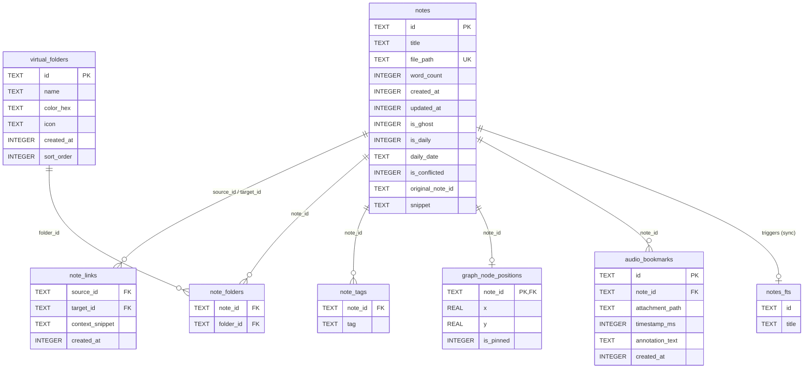

# Architectural Audit Report: Core Domain, Data Layer & Persistence

**Target System:** Prism (Flutter / Android Local-First Markdown Knowledge Base)  
**Audit Component:** Subagent 02 — Core Domain, Data Layer & Persistence  
**Date of Audit:** October 2026  
**Status:** Complete  

---

## 1. Executive Summary

- **Fragile Dual-Source-of-Truth with Catastrophic Vault Rename Data Loss:** Prism maintains a dual persistence model between physical markdown files on disk and an embedded SQLite index (`.prism.db`). Because note records in SQLite store rigid absolute filesystem paths (`file_path TEXT UNIQUE`), operations such as directory renaming or vault relocation cause total metadata severance. Specifically, in [`lib/core/services/vault_service.dart:L108-L136`](file:///home/aadith/development/active-projects/Prism/lib/core/services/vault_service.dart#L108-L136), renaming an active vault renames the OS directory without updating database paths; subsequent re-indexing treats existing notes as brand new, generates fresh UUIDs, and cascades the deletion of all tags, wikilinks, folder assignments, graph coordinates, and audio bookmarks.
- **Leaky and Incomplete Data Abstractions:** While an abstract database interface ([`DatabaseService`](file:///home/aadith/development/active-projects/Prism/lib/core/database/database_service.dart#L13-L65)) was engineered to decouple repositories from raw sqflite types, architectural compliance is fragmented: [`FolderRepository`](file:///home/aadith/development/active-projects/Prism/lib/features/folders/data/folder_repository.dart#L21) and [`GraphNodeRepository`](file:///home/aadith/development/active-projects/Prism/lib/features/graph/data/graph_node_repository.dart#L16) consume `DatabaseService`, whereas the central [`NoteRepository`](file:///home/aadith/development/active-projects/Prism/lib/features/notes/data/note_repository.dart#L22), [`JournalRepository`](file:///home/aadith/development/active-projects/Prism/lib/features/journal/data/journal_repository.dart#L14), and [`AudioBookmarkRepository`](file:///home/aadith/development/active-projects/Prism/lib/features/editor/data/audio_bookmark_repository.dart#L7) completely bypass it to execute queries directly against raw sqflite `Database` instances.
- **Severe UI Thread Contention via 2N+1 Query Amplification:** Note card rendering in list and grid views relies on [`noteDetailsProvider(note.id)`](file:///home/aadith/development/active-projects/Prism/lib/features/notes/presentation/providers/notes_providers.dart#L223-L233) inside [`lib/shared/design_system/cards.dart:L115`](file:///home/aadith/development/active-projects/Prism/lib/shared/design_system/cards.dart#L115). This fires two distinct asynchronous database round-trips (`getNoteById` and `getTagsForNote`) per note card, triggering 200 platform channel database queries to render a 100-note view—despite existing batch APIs ([`NoteRepository.batchGetTagsForAllNotes`](file:///home/aadith/development/active-projects/Prism/lib/features/notes/data/note_repository.dart#L295-L305)) and pre-existing `snippet` fields on the `Note` entity.
- **Deceptive "Full-Text Search" & Unsanitized FTS5 Crash Vulnerability:** The virtual table [`notes_fts`](file:///home/aadith/development/active-projects/Prism/lib/core/database/database_helper.dart#L239-L244) indexes *only* the note `title` with the Porter stemmer; it does not index note body content or snippets. Furthermore, [`searchNotes`](file:///home/aadith/development/active-projects/Prism/lib/features/notes/data/note_repository.dart#L158-L176) strips punctuation but fails to quote or escape SQLite FTS5 reserved keywords (`AND`, `OR`, `NOT`, `NEAR`). Querying for common terms like "not" or "and" crashes the search provider with an unhandled `DatabaseException`.
- **Destructive Markdown Frontmatter Handling & Missing Note Identity:** Prism does not persist its primary entity key (`id`) within the markdown file's YAML frontmatter. More critically, [`EditorController.save`](file:///home/aadith/development/active-projects/Prism/lib/features/editor/presentation/providers/editor_controller.dart#L240-L274) hard-reconstructs the frontmatter block using only `title` and `date`, wiping out all user-defined YAML metadata (tags, aliases, author, status, custom keys) on every save.

---

## 2. Current Architecture Map

### 2.1 Persistence Flow & Component Relationships

```mermaid
flowchart TD
    subgraph UI & State ["Presentation & State (Riverpod)"]
        UI[NoteCard / NotesListScreen / Editor]
        NP[notesProvider]
        NDP[noteDetailsProvider - 2N+1 queries]
        NV[notesVersionProvider / foldersVersionProvider]
    end

    subgraph Repositories ["Data Access Layer (Inconsistent Seams)"]
        NR[NoteRepository\n(Bypasses DatabaseService)]
        FR[FolderRepository\n(Uses DatabaseService)]
        GNR[GraphNodeRepository\n(Uses DatabaseService)]
        JR[JournalRepository\n(Bypasses DatabaseService)]
        ABR[AudioBookmarkRepository\n(Bypasses DatabaseService)]
    end

    subgraph CoreServices ["Core Data & Ingestion Services"]
        DS[DatabaseService / SqliteDatabaseService]
        NIS[NoteIngestionServiceImpl]
        PMS[PrismMetadataStore\n(.prism-metadata.json)]
        DH[DatabaseHelper\nSingleton Queue]
    end

    subgraph Storage ["Dual-Storage Physical Layer"]
        FS[("Vault Filesystem (*.md)\nFlat Directory Structure")]
        DB[("SQLite Database (.prism.db)\nSQLCipher Encrypted (Mobile)\nUnencrypted (Desktop/FFI)")]
        SC[("Sidecar (.prism-metadata.json)\nFolders, Pins")]
    end

    UI --> NP
    UI --> NDP
    NP --> NR
    NDP --> NR
    NR -->|Bypasses Seam| DH
    FR -->|Uses Seam| DS
    GNR -->|Uses Seam| DS
    JR -->|Bypasses Seam| DH
    ABR -->|Bypasses Seam| DH
    DS --> DH
    
    NR --> NIS
    NIS -->|Direct I/O| FS
    NIS -->|Indexes Metadata| DS
    
    FR -->|Flushes| PMS
    GNR -->|Flushes| PMS
    PMS -->|Writes| SC
    
    DH -->|Opens/Closes| DB
    NV -.->|Invalidates All| NP
    NV -.->|Invalidates All| NDP
```

### 2.2 Schema Definitions and Indices

The SQLite database is initialized by [`DatabaseHelper._onCreate`](file:///home/aadith/development/active-projects/Prism/lib/core/database/database_helper.dart#L218-L350) and upgraded up to version 7 ([`DatabaseHelper._onUpgrade`](file:///home/aadith/development/active-projects/Prism/lib/core/database/database_helper.dart#L352-L463)).



### 2.3 Physical Storage Layout & Sidecar Synchronization

Every vault is a directory on disk located at `BaseVaultsDirectory / ActiveVaultName` ([`lib/core/database/vault_providers.dart:L54-L59`](file:///home/aadith/development/active-projects/Prism/lib/core/database/vault_providers.dart#L54-L59)). Within the vault:
1. `*.md`: Note files, named via kebab-case slug and UUID: `p.join(currentVaultPath, '$slug-$id.md')` ([`lib/features/notes/data/adapters/vault_service_impl.dart:L68`](file:///home/aadith/development/active-projects/Prism/lib/features/notes/data/adapters/vault_service_impl.dart#L68)).
2. `.prism.db`: The SQLite database file containing relational tables, indices, and FTS5 virtual tables ([`lib/core/database/database_helper.dart:L12`](file:///home/aadith/development/active-projects/Prism/lib/core/database/database_helper.dart#L12)).
3. `.prism-metadata.json`: The sync-safe sidecar file containing `virtual_folders`, `note_folders`, and `graph_pins` ([`lib/core/database/prism_metadata_store.dart:L22`](file:///home/aadith/development/active-projects/Prism/lib/core/database/prism_metadata_store.dart#L22)).
4. `attachments/`: Audio recordings and media attachments.
5. `templates/` and `.prism/templates/`: Markdown template files.

---

## 3. Critical Flaws & Technical Debt

### Severity: High

#### 1. Catastrophic Metadata Purge on Vault Directory Rename
- **Files & Lines:**  
  [`lib/core/services/vault_service.dart:L108-L136`](file:///home/aadith/development/active-projects/Prism/lib/core/services/vault_service.dart#L108-L136)  
  [`lib/features/notes/data/adapters/vault_service_impl.dart:L263-L375`](file:///home/aadith/development/active-projects/Prism/lib/features/notes/data/adapters/vault_service_impl.dart#L263-L375)
- **Problem Description:**  
  In [`renameVault`](file:///home/aadith/development/active-projects/Prism/lib/core/services/vault_service.dart#L108-L136), the service moves the folder on the filesystem via `Directory(oldPath).rename(newPath)` and updates `activeVaultNameProvider`. It executes *zero* database queries. The SQLite database at `newPath/.prism.db` still contains `notes.file_path` pointing to `oldPath/...`.  
  When `databaseProvider` opens the database in the renamed folder, [`_triggerBackgroundSync`](file:///home/aadith/development/active-projects/Prism/lib/core/database/database_providers.dart#L61-L75) calls [`syncVault`](file:///home/aadith/development/active-projects/Prism/lib/features/notes/data/adapters/vault_service_impl.dart#L253). `existingPathsMap` holds old paths (`oldPath/...`), while disk scanning finds files under `newPath/...`. Because `!exists` evaluates to true for every file:
  1. A new random UUID is generated for every note (`noteId = utils.generateId()`).
  2. The old note rows are flagged as deleted by the orphan pruning pass ([`vault_service_impl.dart:L347-L358`](file:///home/aadith/development/active-projects/Prism/lib/features/notes/data/adapters/vault_service_impl.dart#L347-L358)).
  3. Deleting the old notes triggers `ON DELETE CASCADE` across foreign keys in SQLite.  
- **Impact:**  
  Renaming a vault **permanently obliterates** all folder mappings (`note_folders`), wikilinks (`note_links`), tags (`note_tags`), graph pins (`graph_node_positions`), and audio bookmarks (`audio_bookmarks`). The note files are re-inserted with brand new IDs, severing all relations.

#### 2. Destruction of Custom Markdown Frontmatter on Save
- **Files & Lines:**  
  [`lib/features/editor/presentation/providers/editor_controller.dart:L240-L274`](file:///home/aadith/development/active-projects/Prism/lib/features/editor/presentation/providers/editor_controller.dart#L240-L274)  
  [`lib/core/utils/utils.dart:L100-L126`](file:///home/aadith/development/active-projects/Prism/lib/core/utils/utils.dart#L100-L126)
- **Problem Description:**  
  When a note is saved, [`EditorController.save`](file:///home/aadith/development/active-projects/Prism/lib/features/editor/presentation/providers/editor_controller.dart#L240-L274) constructs a clean frontmatter block from scratch:
  ```dart
  final buffer = StringBuffer();
  buffer.writeln('---');
  buffer.writeln('title: "$cleanTitle"');
  if (dateStr != null) {
    buffer.writeln('date: $dateStr');
  }
  buffer.writeln('---');
  buffer.writeln();
  buffer.write(body);
  ```
- **Impact:**  
  Any YAML frontmatter created outside Prism (e.g. Obsidian metadata, tags, aliases, author, created/updated timestamps, status) is stripped by [`stripFrontmatter`](file:///home/aadith/development/active-projects/Prism/lib/core/utils/utils.dart#L100) on load and permanently destroyed on save. For an offline-first app promoting interoperable markdown vaults, this causes silent, irreversible user data destruction.

#### 3. Note ID Absent from Filesystem Leading to Multi-Device Split-Brain
- **Files & Lines:**  
  [`lib/features/notes/data/adapters/vault_service_impl.dart:L75-L81, L302`](file:///home/aadith/development/active-projects/Prism/lib/features/notes/data/adapters/vault_service_impl.dart#L75-L81)  
  [`lib/core/database/prism_metadata_store.dart:L69-L84`](file:///home/aadith/development/active-projects/Prism/lib/core/database/prism_metadata_store.dart#L69-L84)
- **Problem Description:**  
  The `id` field of a `Note` is never serialized into the markdown frontmatter. While the filename format is `$slug-$id.md`, [`syncVault`](file:///home/aadith/development/active-projects/Prism/lib/features/notes/data/adapters/vault_service_impl.dart#L302) does not parse the UUID suffix from the filename. When a new vault is initialized on a second device or rebuilt after database corruption:
  1. [`loadIntoDatabase`](file:///home/aadith/development/active-projects/Prism/lib/core/database/prism_metadata_store.dart#L35) reads `.prism-metadata.json` and inserts `note_folders` and `graph_pins` using Device A's UUIDs.
  2. [`syncVault`](file:///home/aadith/development/active-projects/Prism/lib/features/notes/data/adapters/vault_service_impl.dart#L253) scans the physical `.md` files. Because `existingPathsMap` is empty, it calls `utils.generateId()` to generate Device B UUIDs for every file.
- **Impact:**  
  Device B's notes have different IDs from Device A. All virtual folder memberships and graph coordinates loaded from the sidecar become dangling foreign keys. Device B shows zero notes inside all virtual folders. Subsequent sidecar flushes from Device B overwrite `.prism-metadata.json`, corrupting Device A upon sync.

#### 4. Hardcoded Fallback Encryption Key Security Risk
- **Files & Lines:**  
  [`lib/core/database/database_helper.dart:L78-L81`](file:///home/aadith/development/active-projects/Prism/lib/core/database/database_helper.dart#L78-L81)
- **Problem Description:**  
  In [`_getDbPassword`](file:///home/aadith/development/active-projects/Prism/lib/core/database/database_helper.dart#L59-L82):
  ```dart
  try {
    String? password = await secureStorage.read(key: key);
    ...
  } catch (e) {
    debugPrint('[DB] Error loading/generating secure storage database password: $e');
    return 'prism_db_fallback_key_2026';
  }
  ```
- **Impact:**  
  If `FlutterSecureStorage` encounters an operational exception (frequent on Android during KeyStore initialization or post-reboot locked states), the database is encrypted with a publicly known plaintext string (`prism_db_fallback_key_2026`). On the next launch, when `FlutterSecureStorage` recovers and provides the real key, SQLCipher fails to decrypt, classifies the DB as corrupted, moves it to `.prism.db.corrupt` ([`database_helper.dart:L150`](file:///home/aadith/development/active-projects/Prism/lib/core/database/database_helper.dart#L150)), and destroys user database state.

#### 5. Silent Overwrite of Remote Files Post-Cloud-Sync
- **Files & Lines:**  
  [`lib/core/services/two_way_sync_service.dart:L329-L525`](file:///home/aadith/development/active-projects/Prism/lib/core/services/two_way_sync_service.dart#L329-L525)  
  [`lib/features/settings/presentation/screens/cloud_sync_screen.dart:L193-L212`](file:///home/aadith/development/active-projects/Prism/lib/features/settings/presentation/screens/cloud_sync_screen.dart#L193-L212)
- **Problem Description:**  
  When [`TwoWaySyncServiceImpl.runSync`](file:///home/aadith/development/active-projects/Prism/lib/core/services/two_way_sync_service.dart#L186) downloads modified or new files from Google Drive, it writes the bytes directly to disk via `localFile.writeAsBytes(fileBytes)`.  
  However, it **never calls** `noteIngestionService.syncVault(vaultPath)` and **never reloads** `.prism-metadata.json` via `PrismMetadataStore().loadIntoDatabase()`. Neither does it increment `notesVersionProvider` or `foldersVersionProvider`.
- **Impact:**  
  Downloaded notes and updated metadata do not appear in SQLite or Riverpod state. The user is told "Sync completed successfully" via toast, but newly downloaded files are invisible in the UI until the process is killed and cold-restarted.

---

### Severity: Medium

#### 6. 2N+1 Asynchronous Database Query Amplification in Note Lists
- **Files & Lines:**  
  [`lib/shared/design_system/cards.dart:L115`](file:///home/aadith/development/active-projects/Prism/lib/shared/design_system/cards.dart#L115)  
  [`lib/features/notes/presentation/providers/notes_providers.dart:L223-L233`](file:///home/aadith/development/active-projects/Prism/lib/features/notes/presentation/providers/notes_providers.dart#L223-L233)
- **Problem Description:**  
  Each `NoteCard` renders by calling `ref.watch(noteDetailsProvider(note.id))`. In `noteDetailsProvider`:
  ```dart
  final note = await repo.getNoteById(noteId); // Query 1: SELECT * FROM notes WHERE id = ?
  final snippet = note?.snippet ?? '';
  final tags = await repo.getTagsForNote(noteId); // Query 2: SELECT tag FROM note_tags WHERE note_id = ?
  ```
  `note.snippet` is already present on the parent `Note` model passed to `NoteCard`. Furthermore, `NoteRepository` already provides a batch API (`batchGetTagsForAllNotes`).
- **Impact:**  
  For a vault with 100 notes, opening `NotesListScreen` dispatches 201 independent asynchronous database calls over the Flutter platform channel. Every 500ms debounce during note typing increments `notesVersionProvider`, re-triggering all 200 queries and causing severe frame drops.

#### 7. Ghost Note Duplicate Row Accumulation
- **Files & Lines:**  
  [`lib/features/notes/data/adapters/sqlite_metadata_indexer.dart:L160-L182`](file:///home/aadith/development/active-projects/Prism/lib/features/notes/data/adapters/sqlite_metadata_indexer.dart#L160-L182)  
  [`lib/features/notes/data/adapters/vault_service_impl.dart:L268-L305`](file:///home/aadith/development/active-projects/Prism/lib/features/notes/data/adapters/vault_service_impl.dart#L268-L305)
- **Problem Description:**  
  When note A mentions `[[My Ghost]]`, `SqliteMetadataIndexer` inserts a row into `notes` with `is_ghost = 1` and a generated UUID.  
  If the user subsequently creates `My Ghost.md` via an external tool (or via sync), `syncVault` filters `existingNotes` where `is_ghost == 0` ([`vault_service_impl.dart:L268`](file:///home/aadith/development/active-projects/Prism/lib/features/notes/data/adapters/vault_service_impl.dart#L268)). It sees `My Ghost.md` as unknown, generates *another* UUID, and inserts a second row with `is_ghost = 0`.
- **Impact:**  
  The database retains two distinct rows with title "My Ghost". The ghost note is not pruned because backlinks still point to its `target_id`. Wikilink queries (`WHERE title COLLATE NOCASE IN (...)`) match non-deterministically, leading to fractured backlink indices.

#### 8. FTS5 Keyword Crash and Bogus Full-Text Search
- **Files & Lines:**  
  [`lib/core/database/database_helper.dart:L239-L244`](file:///home/aadith/development/active-projects/Prism/lib/core/database/database_helper.dart#L239-L244)  
  [`lib/features/notes/data/note_repository.dart:L158-L176`](file:///home/aadith/development/active-projects/Prism/lib/features/notes/data/note_repository.dart#L158-L176)
- **Problem Description:**  
  1. The FTS table definition is:
     ```sql
     CREATE VIRTUAL TABLE IF NOT EXISTS notes_fts USING fts5(id, title, tokenize = 'porter');
     ```
     The table only contains `title`. Note bodies are never indexed. Calling this a "full-text search" is architecturally inaccurate; it is merely a stemmed title search.
  2. In `searchNotes`, user input is cleaned with `replaceAll(RegExp(r'[^\w\s\-]'), ' ')` and appended with `*` (`['$sanitizedQuery*']`).
- **Impact:**  
  If a user searches for boolean keywords like "not", "and", "or", or "near", SQLite FTS5 parses them as syntax operators without operands, throwing an unhandled `sqlite3.OperationalError: fts5: syntax error`. The search results provider crashes into an error state.

#### 9. Missing Index on `notes(created_at)` and Filter Mismatches
- **Files & Lines:**  
  [`lib/core/database/database_helper.dart:L313-L324`](file:///home/aadith/development/active-projects/Prism/lib/core/database/database_helper.dart#L313-L324)  
  [`lib/features/notes/data/note_repository.dart:L60-L118`](file:///home/aadith/development/active-projects/Prism/lib/features/notes/data/note_repository.dart#L60-L118)
- **Problem Description:**  
  1. `NoteSort.created` orders by `created_at DESC`. There is no index on `created_at` in the database schema. Every sort by creation date requires a full table scan and an in-memory B-tree sort.
  2. `getAllNonDailyNotes` filters by `is_ghost = 0 AND is_daily = 0`. The available composite indexes are `(is_ghost, updated_at DESC)` and `(is_ghost, is_daily, daily_date)`. Neither covers `(is_ghost, is_daily, updated_at DESC)`.
  3. `AudioBookmarkRepository.getBookmarksForAttachment` queries `WHERE note_id = ? AND attachment_path = ? ORDER BY timestamp_ms ASC`. The only index is on `audio_bookmarks(note_id)`.
- **Impact:**  
  Query execution time degrades linearly with vault size, causing noticeable UI stutter during sorting switches on large vaults.

#### 10. Correlated Subquery Overhead in Graph Repository
- **Files & Lines:**  
  [`lib/features/graph/data/graph_node_repository.dart:L35-L43`](file:///home/aadith/development/active-projects/Prism/lib/features/graph/data/graph_node_repository.dart#L35-L43)
- **Problem Description:**  
  In `getGraphData()`:
  ```sql
  SELECT n.id, n.title, n.is_daily, n.daily_date, n.is_ghost, n.created_at,
    (SELECT COUNT(*) FROM (
      SELECT 1 FROM note_links WHERE source_id = n.id
      UNION ALL
      SELECT 1 FROM note_links WHERE target_id = n.id
    )) as link_count
  FROM notes n
  ```
- **Impact:**  
  For $N$ notes, this executes $N$ scalar subqueries with internal `UNION ALL` scans. In a vault of 1,000 notes with 3,000 links, this blocks the database executor and causes UI freezing on navigation to the Graph view. A single `LEFT JOIN` on an aggregated subquery would reduce execution to $O(N + E)$.

---

### Severity: Low

#### 11. Partial Entity Synchronization: Audio Bookmarks Omitted from Sidecar
- **Files & Lines:**  
  [`lib/core/database/prism_metadata_store.dart:L104-L129`](file:///home/aadith/development/active-projects/Prism/lib/core/database/prism_metadata_store.dart#L104-L129)
- **Problem Description:**  
  The `.prism-metadata.json` sidecar tracks `virtual_folders`, `note_folders`, and `graph_pins`. The `audio_bookmarks` table (introduced in v4) is completely absent from the sidecar.
- **Impact:**  
  Audio bookmarks exist only in `.prism.db`. If `.prism.db` is rebuilt from filesystem notes or migrated across devices via cloud sync, all audio timestamps and annotations are lost.

#### 12. Non-Atomic File & Database Mutations
- **Files & Lines:**  
  [`lib/features/notes/data/adapters/vault_service_impl.dart:L87-L117, L245-L250`](file:///home/aadith/development/active-projects/Prism/lib/features/notes/data/adapters/vault_service_impl.dart#L87-L117)
- **Problem Description:**  
  In `createNote` and `deleteNote`, disk I/O operations (`storage.writeContent` / `storage.deleteContent`) are executed outside the database transaction. If the database transaction aborts (e.g., constraint error, device storage full), the filesystem and SQLite state immediately diverge.

#### 13. Broken Conflict Merge File Formatting
- **Files & Lines:**  
  [`lib/features/editor/presentation/screens/merge_comparison_screen.dart:L170-L177`](file:///home/aadith/development/active-projects/Prism/lib/features/editor/presentation/screens/merge_comparison_screen.dart#L170-L177)
- **Problem Description:**  
  When merging conflicting notes using `_mergeBoth()`, the method creates:
  ```markdown
  # Conflict Resolved: Note Title
  
  <<<<<<< ORIGINAL COPY
  ---
  title: "Note Title"
  ---
  Original Body
  =======
  ---
  title: "Note Title"
  ---
  Conflicted Body
  >>>>>>> CONFLICTED COPY
  ```
- **Impact:**  
  The resulting file contains two invalid nested frontmatter blocks within git conflict markers. When indexed, [`stripFrontmatter`](file:///home/aadith/development/active-projects/Prism/lib/core/utils/utils.dart#L100) fails (file does not begin with `---`), causing raw YAML frontmatter syntax to leak into the note body and corrupting search snippets.

---

## 4. Architectural Mismatches

| Architecture Principle | Prism Implementation | Specific Code Friction |
| :--- | :--- | :--- |
| **Local-First Interoperability (POSIX/Obsidian Compatible)** | File path as primary relational foreign key in SQLite | Files are named `$slug-$id.md`, but renaming a note or moving directories breaks all foreign keys in SQLite. External changes to file names cause catastrophic cascade deletions ([`vault_service.dart:L126`](file:///home/aadith/development/active-projects/Prism/lib/core/services/vault_service.dart#L126)). |
| **Separation of Concerns (Domain vs Data)** | Anemic models merged with SQLite schema | Domain entities do not exist under `lib/features/**/domain/`. Models live in `data/` and hardcode SQLite column names in `fromMap`/`toMap` ([`note_model.dart:L28-L72`](file:///home/aadith/development/active-projects/Prism/lib/features/notes/data/note_model.dart#L28-L72)). |
| **Repository Pattern & Testability Seams** | Direct platform channel sqflite coupling | `DatabaseService` abstraction is bypassed by `NoteRepository`, `JournalRepository`, and `AudioBookmarkRepository`, which read raw `databaseProvider` ([`note_repository.dart:L22`](file:///home/aadith/development/active-projects/Prism/lib/features/notes/data/note_repository.dart#L22)). |
| **Single Source of Truth** | Quadruple-Source Fragmentation | Data is split across: (1) Markdown files, (2) `.prism.db`, (3) `.prism-metadata.json`, and (4) `SharedPreferences`. No unified change-data-capture or reconciliation mechanism exists. |
| **Reactive Fine-Grained State** | Global monolithic version counters | Typing a character in a single note increments `notesVersionProvider`, invalidating all active note list queries, tag clouds, and statistics across the app ([`editor_controller.dart:L265`](file:///home/aadith/development/active-projects/Prism/lib/features/editor/presentation/providers/editor_controller.dart#L265)). |

---

## 5. Raw Questions for the Principal Architect

1. **Identity Grounding:** Why is the Note `id` (UUID) not written into the markdown YAML frontmatter? If Prism adopted standard frontmatter `id: <uuid>` (or parsed the trailing UUID from `$slug-$id.md`), vault renames, file moves, and multi-device sync would never trigger cascade deletions or create split-brain orphans.
2. **True Full-Text Search vs Content Ingestion:** If note contents only reside in physical `.md` files and are omitted from SQLite, what is the strategy for actual body text search? Should note content be stored in an SQLite FTS5 content table, or should FTS5 be configured as an external content table pointing to a content cache?
3. **Preservation of Third-Party Markdown Frontmatter:** Why does `EditorController.save()` completely overwrite the frontmatter block instead of parsing the existing YAML AST, updating only `title`/`date`, and preserving third-party metadata keys?
4. **Enforcement of `DatabaseService`:** Was `DatabaseService` intended as an incomplete migration or a permanent architectural standard? Should all direct calls to `databaseProvider` in `NoteRepository` and `JournalRepository` be replaced with `databaseServiceProvider`?
5. **Reconciliation Mechanism for External Vault Edits:** In the absence of a `Directory.watch` filesystem listener, how should Prism detect out-of-band edits by third-party tools (Syncthing, Obsidian, Git) without forcing a complete app restart?
