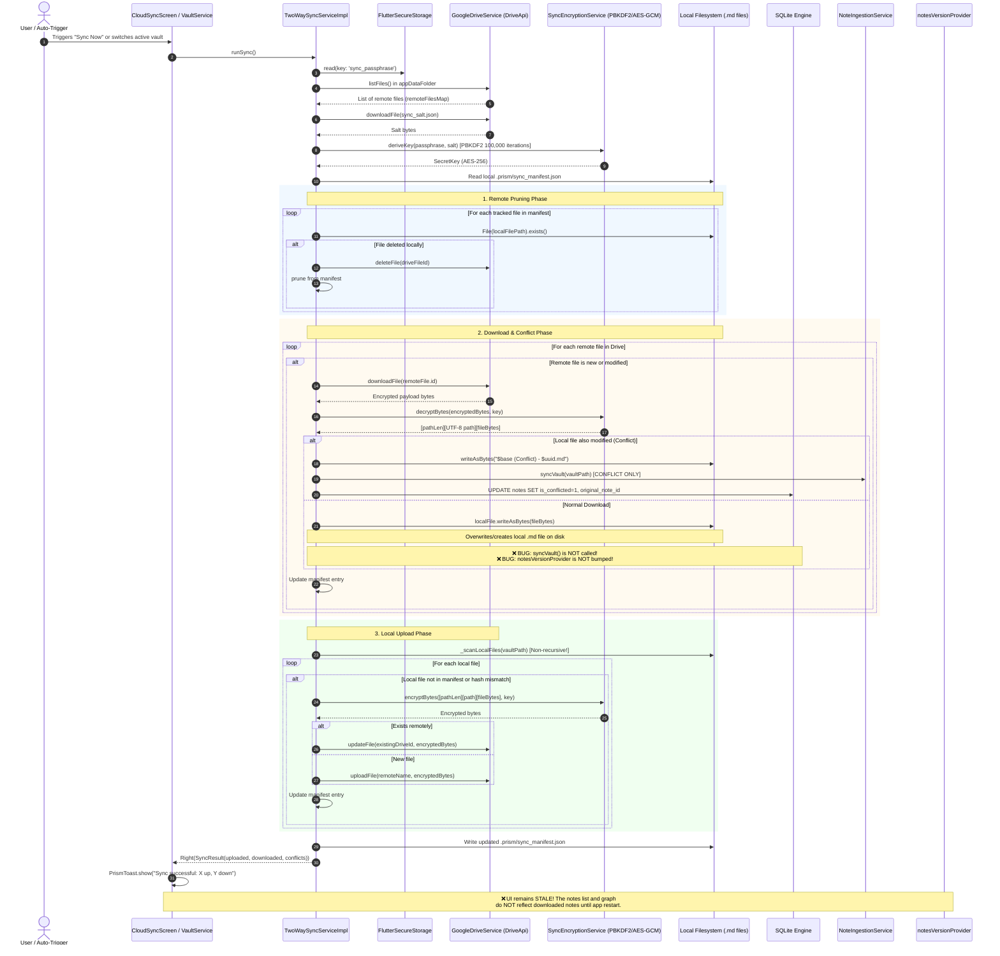

# Deep-Dive Architectural Audit: State Management, Reactivity & Data Flow
**Target Repository:** Prism (Flutter / Riverpod v2 / SQLite / Google Drive Cloud Sync)  
**Report Document:** `audit-reports/03-state-and-dataflow.md`  
**Auditor:** Subagent 3 — API, State Management & Data Flow  
**Date:** October 2026  
**Status:** Complete / Brutally Honest / Code-Referenced  

---

## 1. Executive Summary

- **Coarse-Grained "Version Bus" Invalidation Model:** Prism eschews fine-grained, entity-level reactivity in favor of global integer counters (`NotesVersion` at [`lib/core/database/database_providers.dart:L78-L92`](file:///home/aadith/development/active-projects/Prism/lib/core/database/database_providers.dart#L78-L92) and `FoldersVersion` at [`lib/core/database/database_providers.dart:L94-L108`](file:///home/aadith/development/active-projects/Prism/lib/core/database/database_providers.dart#L94-L108)). A single keystroke auto-save on a solitary note increments `notesVersionProvider`, cascading instantaneous re-queries across note lists, recent notes, unique tag collections, aggregate vault statistics, search results, and the entire 2D wikilink graph layout computation.
- **Critical Cloud-Sync-to-UI Disconnect (Silent Stale State):** While `TwoWaySyncService` ([`lib/core/services/two_way_sync_service.dart:L186-L615`](file:///home/aadith/development/active-projects/Prism/lib/core/services/two_way_sync_service.dart#L186-L615)) successfully downloads, decrypts, and writes remote `.md` files to the filesystem, it fails to invoke `noteIngestionService.syncVault()` or increment `notesVersionProvider` upon completing routine file downloads or updates. As a consequence, downloaded notes remain completely invisible to the SQLite index and the UI until the application process is terminated and restarted or resumed from background.
- **Irreversible Frontmatter Data Destruction:** `EditorController` ([`lib/features/editor/presentation/providers/editor_controller.dart:L112`](file:///home/aadith/development/active-projects/Prism/lib/features/editor/presentation/providers/editor_controller.dart#L112), [`L246-L255`](file:///home/aadith/development/active-projects/Prism/lib/features/editor/presentation/providers/editor_controller.dart#L246-L255)) strips all YAML frontmatter when loading a note and re-serializes *only* `title` and `date` upon saving. Any external Markdown frontmatter attributes (e.g. `tags`, `aliases`, `author`, `status`, or Obsidian/Jekyll custom metadata) are permanently and silently wiped from the user's files upon the first auto-save.
- **Pervasive Security & Paywall Gate Bypass:** Navigation routing in `appRouterProvider` ([`lib/core/router/app_router.dart:L105`](file:///home/aadith/development/active-projects/Prism/lib/core/router/app_router.dart#L105), [`L260`](file:///home/aadith/development/active-projects/Prism/lib/core/router/app_router.dart#L260)) gates Pro features solely on compile-time / runtime config (`AppConfig.enableSubscriptions`) rather than reactive user entitlement (`isProProvider`). Furthermore, screens such as `SecuritySettingsScreen` ([`lib/features/settings/presentation/screens/security_settings_screen.dart:L421`](file:///home/aadith/development/active-projects/Prism/lib/features/settings/presentation/screens/security_settings_screen.dart#L421)) directly route to `/settings/cloud-sync` without any Pro gate tile, allowing non-paying users unrestricted access to cloud sync.
- **Dual-State Dynamic Island Architecture & Static Context Anti-Patterns:** Dynamic Island coordination is fragmented between a unified sealed-class notifier (`DynamicIslandNotifier` at [`lib/shared/widgets/dynamic_island_state.dart:L71`](file:///home/aadith/development/active-projects/Prism/lib/shared/widgets/dynamic_island_state.dart#L71)) and four auxiliary individual notifiers (`islandToastNotifierProvider`, `islandMenuNotifierProvider`, `quickCaptureNotifierProvider`, `vaultHubNotifierProvider`). Static display helpers imperatively reach into the widget tree via `ProviderScope.containerOf(context, listen: false)` ([`lib/shared/widgets/prism_toast.dart:L112`](file:///home/aadith/development/active-projects/Prism/lib/shared/widgets/prism_toast.dart#L112)), bypassing declarative Riverpod parameter passing.

---

## 2. Current Architecture Map & End-to-End Lifecycles

### 2.1 Note Creation & Typing Lifecycle

This trace captures the path of a user typing in the Markdown editor: from a raw text mutation to debounced disk persistence, SQLite transactional indexing, FTS5 triggers, wikilink ghost materialization, and the resulting reactive invalidation wave.

```mermaid
sequenceDiagram
    autonumber
    actor User as User Keyboard
    participant LP as LivePreviewController<br/>(TextEditingController)
    participant ES as EditorScreen<br/>(ConsumerStatefulWidget)
    participant EC as EditorController<br/>(Riverpod AutoDispose Notifier)
    participant NR as NoteRepository
    participant NIS as NoteIngestionServiceImpl
    participant VS as LocalVaultStorage
    participant SMI as SqliteMetadataIndexer
    participant DB as SQLite Engine (WAL mode)
    participant NV as notesVersionProvider<br/>(Integer Version Bus)
    participant UI as Dependent UI Providers<br/>(notes, graphData, vaultStats)

    User->>LP: Keystroke input
    LP->>ES: notifyListeners()
    ES->>EC: onTextChanged(title, body, selection, isRecording)
    EC->>EC: _detectWikilink() -> update wikilink popup state
    EC->>EC: _saveTimer?.cancel(); Timer(500ms, save)
    Note over EC: 500ms Debounce Elapses
    EC->>EC: save(title, body) -> build YAML frontmatter (title, date)
    EC->>NR: repo.saveNote(noteId, content)
    NR->>NIS: _vaultService.saveNote(noteId, content)
    NIS->>VS: storage.writeContent(filePath, content)
    Note over VS: Physical .md file written to disk
    NIS->>NIS: parser.parse(content) -> NoteMetadata
    NIS->>DB: database.transaction()
    NIS->>SMI: indexer.indexNote(txn, ...)
    SMI->>DB: UPDATE notes SET title, word_count, snippet, updated_at
    Note over DB: SQLite Triggers notes_au fire:<br/>DELETE FROM notes_fts; INSERT INTO notes_fts
    SMI->>DB: DELETE FROM note_tags; INSERT INTO note_tags (batch)
    SMI->>DB: DELETE FROM note_links WHERE source_id = noteId
    loop For each [[target]] in metadata.wikilinks
        alt Target note does not exist
            SMI->>DB: INSERT INTO notes (is_ghost=1, targetFilePath)
        end
        SMI->>DB: INSERT INTO note_links (source_id, target_id, snippet)
    end
    DB-->>NIS: Transaction committed
    NIS-->>NR: saveNote completed
    NR->>NV: _ref.read(notesVersionProvider.notifier).state++
    Note over NV: notesVersionProvider increments: N -> N+1
    NV-->>UI: Invalidation notification
    par Cascade Re-queries
        UI->>DB: notesProvider: SELECT * FROM notes ...
        UI->>DB: graphDataProvider: SELECT note_links + notes ...
        UI->>DB: vaultStatsProvider: SELECT COUNT(*), SUM(word_count) ...
        UI->>DB: uniqueTagsProvider: SELECT DISTINCT tag ...
        UI->>DB: recentNotesProvider: SELECT * ... LIMIT 5
    end
    EC->>EC: state = state.copyWith(isSaving: false, lastSaved: content)
```

#### Exact Code Path References:
1. **Keystroke Listener:** [`lib/features/editor/presentation/screens/editor_screen.dart:L157-L193`](file:///home/aadith/development/active-projects/Prism/lib/features/editor/presentation/screens/editor_screen.dart#L157-L193) — `_controller.addListener(_onTextChanged)`.
2. **Debounce Logic:** [`lib/features/editor/presentation/providers/editor_controller.dart:L204-L208`](file:///home/aadith/development/active-projects/Prism/lib/features/editor/presentation/providers/editor_controller.dart#L204-L208) — `_saveTimer = Timer(const Duration(milliseconds: 500), () => save(title, body))`.
3. **YAML Serialization & Stripping:** [`lib/features/editor/presentation/providers/editor_controller.dart:L246-L255`](file:///home/aadith/development/active-projects/Prism/lib/features/editor/presentation/providers/editor_controller.dart#L246-L255) — recreates frontmatter containing only `title` and `date`.
4. **Physical Write:** [`lib/features/notes/data/adapters/vault_service_impl.dart:L216`](file:///home/aadith/development/active-projects/Prism/lib/features/notes/data/adapters/vault_service_impl.dart#L216) — `await storage.writeContent(note.filePath, content)`.
5. **Relational Indexing & Wikilink Extraction:** [`lib/features/notes/data/adapters/sqlite_metadata_indexer.dart:L117-L195`](file:///home/aadith/development/active-projects/Prism/lib/features/notes/data/adapters/sqlite_metadata_indexer.dart#L117-L195).
6. **FTS Triggers:** [`lib/core/database/database_helper.dart:L248-L264`](file:///home/aadith/development/active-projects/Prism/lib/core/database/database_helper.dart#L248-L264) — `notes_ai`, `notes_au`, `notes_ad` automatic SQLite triggers.
7. **Version Bump:** [`lib/features/notes/data/note_repository.dart:L232`](file:///home/aadith/development/active-projects/Prism/lib/features/notes/data/note_repository.dart#L232) — `_ref.read(notesVersionProvider.notifier).state++`.
8. **Reactive Invalidation:** [`lib/features/notes/presentation/providers/notes_providers.dart:L55-L108`](file:///home/aadith/development/active-projects/Prism/lib/features/notes/presentation/providers/notes_providers.dart#L55-L108) and [`lib/features/graph/presentation/providers/graph_providers.dart:L16`](file:///home/aadith/development/active-projects/Prism/lib/features/graph/presentation/providers/graph_providers.dart#L16).

---

### 2.2 Cloud / Google Drive Sync Cycle

This trace highlights the end-to-end synchronization pipeline: local file collection, remote listing, salt derivation, cryptographic decryption/encryption, conflict generation, and the critical point where synchronization fails to notify the local database.



#### Exact Code Path References:
1. **Passphrase and Key Derivation:** [`lib/core/services/two_way_sync_service.dart:L231-L274`](file:///home/aadith/development/active-projects/Prism/lib/core/services/two_way_sync_service.dart#L231-L274) — PBKDF2-HMAC-SHA256 with 100,000 iterations via `SyncEncryptionService` ([`lib/core/services/sync_encryption_service.dart:L50-L69`](file:///home/aadith/development/active-projects/Prism/lib/core/services/sync_encryption_service.dart#L50-L69)).
2. **Local Deletion Propagation:** [`lib/core/services/two_way_sync_service.dart:L303-L317`](file:///home/aadith/development/active-projects/Prism/lib/core/services/two_way_sync_service.dart#L303-L317) — deletes remote files when missing from local disk.
3. **Conflict Resolution Branch:** [`lib/core/services/two_way_sync_service.dart:L397-L481`](file:///home/aadith/development/active-projects/Prism/lib/core/services/two_way_sync_service.dart#L397-L481) — creates `(Conflict) - {uuid}.md` file and calls `syncVault` *only* inside this conditional block.
4. **Normal Remote Download (Missing Invalidation):** [`lib/core/services/two_way_sync_service.dart:L360-L380`](file:///home/aadith/development/active-projects/Prism/lib/core/services/two_way_sync_service.dart#L360-L380) and [`L504-L522`](file:///home/aadith/development/active-projects/Prism/lib/core/services/two_way_sync_service.dart#L504-L522) — writes files to disk via `writeAsBytes`, updates in-memory manifest, but completely omits calling `noteIngestionService.syncVault()` or bumping `notesVersionProvider`.
5. **Local Upload Loop:** [`lib/core/services/two_way_sync_service.dart:L527-L600`](file:///home/aadith/development/active-projects/Prism/lib/core/services/two_way_sync_service.dart#L527-L600).
6. **UI Invocation & Missing Refresh:** [`lib/features/settings/presentation/screens/cloud_sync_screen.dart:L193-L212`](file:///home/aadith/development/active-projects/Prism/lib/features/settings/presentation/screens/cloud_sync_screen.dart#L193-L212).

---

### 2.3 Dynamic Island Event Broker & Presentation State Flow

The Dynamic Island uses a hybrid architecture where state transitions are dispatched via `DynamicIslandNotifier`, but presentation is split across multiple independent notifiers and static imperative helper methods.

```mermaid
flowchart TD
    subgraph Triggers["UI Triggers & Static Helpers"]
        T1["PrismToast.show(context, message)"]
        T2["IslandMenu.show(context, title, items)"]
        T3["User taps Quick Capture FAB"]
        T4["User taps Vault Hub Capsule / Search Bar"]
    end

    subgraph StateCoordination["Dynamic Island Riverpod State Machine"]
        DIS["dynamicIslandControllerProvider<br/>(DynamicIslandNotifier)"]
        ITN["islandToastNotifierProvider<br/>(IslandToastNotifier)"]
        IMN["islandMenuNotifierProvider<br/>(IslandMenuNotifier)"]
        QCN["quickCaptureNotifierProvider<br/>(QuickCaptureNotifier)"]
        VHN["vaultHubNotifierProvider<br/>(VaultHubNotifier)"]
    end

    subgraph Presentation["AppShell UI Layer (lib/shared/widgets/app_shell.dart)"]
        AS_Listen["ref.listen(dynamicIslandControllerProvider)"]
        AS_Watch["ref.watch(dynamicIslandControllerProvider) [L1338]"]
        AS_WatchSubs["ref.watch(quickCaptureNotifierProvider) [L944]<br/>ref.watch(islandToastNotifierProvider) [L988]<br/>ref.watch(islandMenuNotifierProvider) [L989]<br/>ref.watch(vaultHubNotifierProvider) [L990]"]
        Anim["AnimationControllers:<br/>_expansionController<br/>_menuExpansionController<br/>_quickCaptureController<br/>_vaultHubController"]
        Widgets["Dynamic Island Shelf Rendering:<br/>- Toast Shelf<br/>- Menu Deck<br/>- Quick Capture Bottom Sheet<br/>- Vault Hub Deck"]
    end

    T1 -->|Imperative container.read| ITN
    ITN -->|showToast()| DIS
    T2 -->|Imperative container.read| IMN
    IMN -->|showMenu()| DIS
    T3 -->|openQuickCapture()| DIS
    T4 -->|openVaultHub()| DIS

    DIS -.->|State changes| AS_Listen
    DIS -.->|Redundant watch| AS_Watch
    DIS -.->|Watched by| ITN
    DIS -.->|Watched by| IMN
    QCN -.->|Watched by| AS_WatchSubs
    ITN -.->|Watched by| AS_WatchSubs
    IMN -.->|Watched by| AS_WatchSubs
    VHN -.->|Watched by| AS_WatchSubs

    AS_Listen -->|Drives| Anim
    Anim -->|Transforms| Widgets
    AS_Watch -->|Triggers full rebuild of| Presentation
```

#### Exact Code Path References:
1. **Dynamic Island State Union:** [`lib/shared/widgets/dynamic_island_state.dart:L15-L67`](file:///home/aadith/development/active-projects/Prism/lib/shared/widgets/dynamic_island_state.dart#L15-L67) — `DynamicIslandResting`, `DynamicIslandToast`, `DynamicIslandMenu`, `DynamicIslandQuickCapture`, `DynamicIslandVaultHub`.
2. **Unified Notifier:** [`lib/shared/widgets/dynamic_island_state.dart:L71-L154`](file:///home/aadith/development/active-projects/Prism/lib/shared/widgets/dynamic_island_state.dart#L71-L154).
3. **Cross-Notifier Dismissals:** [`lib/shared/widgets/dynamic_island_state.dart:L76-L78`](file:///home/aadith/development/active-projects/Prism/lib/shared/widgets/dynamic_island_state.dart#L76-L78), [`L83-L85`](file:///home/aadith/development/active-projects/Prism/lib/shared/widgets/dynamic_island_state.dart#L83-L85), [`L110`](file:///home/aadith/development/active-projects/Prism/lib/shared/widgets/dynamic_island_state.dart#L110), [`L150`](file:///home/aadith/development/active-projects/Prism/lib/shared/widgets/dynamic_island_state.dart#L150) — directly calls `ref.read(quickCaptureNotifierProvider.notifier).dismiss()`.
4. **Static ProviderScope Access:** [`lib/shared/widgets/prism_toast.dart:L112`](file:///home/aadith/development/active-projects/Prism/lib/shared/widgets/prism_toast.dart#L112) and [`lib/shared/widgets/island_menu.dart:L90`](file:///home/aadith/development/active-projects/Prism/lib/shared/widgets/island_menu.dart#L90) — `ProviderScope.containerOf(context, listen: false)`.
5. **AppShell Dual Listening & Rebuilding:** [`lib/shared/widgets/app_shell.dart:L1300-L1338`](file:///home/aadith/development/active-projects/Prism/lib/shared/widgets/app_shell.dart#L1300-L1338).

---

## 3. Client/UI State Architecture & Partitioning

Prism partitions its runtime state across four distinct storage mechanisms:

| State Layer | Mechanism | Scope & Examples | Lifetime |
|---|---|---|---|
| **Ephemeral Widget State** | `StatefulWidget` / `State<T>` | Text controllers (`_titleController`), text selections, scroll positions, transient animation controllers, local checkbox indices, collapsed headings set (`_collapsedHeadings`). | Disposed when screen pops or unmounts. |
| **Reactive Client State** | Riverpod Notifiers (`@riverpod`, `Notifier`, `AsyncNotifier`) | Active vault path, selected tag filter, search query string, editor mode, audio recording duration, dynamic island presentation state, active theme type. | Retained in `ProviderContainer` (global or `autoDispose`). |
| **Navigation State** | GoRouter (`AppRouter`) | Path parameters (`:id`), query parameters (`?new=true&date=...`), shell tab index derived from `state.uri.path`. | Managed by GoRouter history stack. |
| **Persistent Domain State** | SQLite (`sqflite`), Sidecar JSON, SecureStorage, SharedPreferences | Notes, tags, wikilinks, folders, FTS5 virtual table, sync manifest, PBKDF2 passphrase salt, font size/family settings. | Survives app restarts on disk. |

### Bad Practices Identified in Codebase:

1. **Global Mutable State in UI Files (Anti-Pattern):**
   - [`lib/features/journal/presentation/screens/journal_screen.dart:L19-L20`](file:///home/aadith/development/active-projects/Prism/lib/features/journal/presentation/screens/journal_screen.dart#L19-L20):
     ```dart
     final selectedDayProvider = StateProvider<DateTime>((ref) => DateTime.now());
     final focusedDayProvider = StateProvider<DateTime>((ref) => DateTime.now());
     ```
     These are top-level global `StateProvider`s declared inside a presentation screen file. Any widget mutating `ref.read(selectedDayProvider.notifier).state = ...` mutates un-scoped global state that persists across screen unmounts, causing calendar date desynchronization when navigating away and returning.
   - [`lib/features/graph/presentation/providers/graph_providers.dart:L7-L8`](file:///home/aadith/development/active-projects/Prism/lib/features/graph/presentation/providers/graph_providers.dart#L7-L8):
     `graphViewportStateProvider` (`StateProvider<Matrix4?>`) and `graphAutoFitPerformedProvider` (`StateProvider<bool>`).
   - [`lib/features/settings/presentation/providers/startup_actions.dart:L6`](file:///home/aadith/development/active-projects/Prism/lib/features/settings/presentation/providers/startup_actions.dart#L6):
     `startupActionsEvaluatedProvider = StateProvider<bool>((ref) => false);`

2. **Redundant & Ghost Watches in Build Methods:**
   - [`lib/shared/widgets/app_shell.dart:L1338-L1339`](file:///home/aadith/development/active-projects/Prism/lib/shared/widgets/app_shell.dart#L1338-L1339):
     ```dart
     ref.watch(dynamicIslandControllerProvider);
     ref.watch(availableVaultsProvider);
     ```
     The return values are completely discarded. These calls exist solely as side-effect triggers to force rebuilding the entire `AppShell` widget tree (1517 lines) whenever any dynamic island animation or vault collection event occurs.
   - [`lib/features/notes/presentation/screens/notes_list_screen.dart:L48`](file:///home/aadith/development/active-projects/Prism/lib/features/notes/presentation/screens/notes_list_screen.dart#L48):
     ```dart
     // Pre-warm available vaults list cache so the selector bottom sheet loads instantly
     ref.watch(availableVaultsProvider);
     ```
     Pre-warming an asynchronous provider by watching it inside a top-level screen's build method forces `NotesListScreen` to re-render whenever vaults are added or modified, even when the vault selector bottom sheet is closed.

3. **Untracked Side Effects Mutating Controllers During Build:**
   - [`lib/features/editor/presentation/screens/editor_screen.dart:L278`](file:///home/aadith/development/active-projects/Prism/lib/features/editor/presentation/screens/editor_screen.dart#L278):
     ```dart
     _controller.mode = mode;
     ```
     Mutating controller state inside `Widget.build()` violates Flutter’s unidirectional data flow, risking inconsistent rendering passes or layout exceptions during active paint cycles.

4. **Circular / Redundant Notifier Entanglement:**
   - `IslandToastNotifier` ([`lib/shared/widgets/prism_toast.dart:L54`](file:///home/aadith/development/active-projects/Prism/lib/shared/widgets/prism_toast.dart#L54)) watches `dynamicIslandControllerProvider` in its `build()` method. When `show()` is invoked on `IslandToastNotifier`, it writes to `dynamicIslandControllerProvider` ([`L77`](file:///home/aadith/development/active-projects/Prism/lib/shared/widgets/prism_toast.dart#L77)), which then re-triggers `IslandToastNotifier.build()`. Simultaneously, `DynamicIslandNotifier.showToast()` ([`lib/shared/widgets/dynamic_island_state.dart:L77`](file:///home/aadith/development/active-projects/Prism/lib/shared/widgets/dynamic_island_state.dart#L77)) imperatively calls `quickCaptureNotifierProvider.notifier.dismiss()`.

---

## 4. Contracts, Data Validation & Type Safety

### 4.1 Boundary Input Validation
- **Vault Name Path Validation:**
  [`lib/core/services/vault_service.dart:L89-L92`](file:///home/aadith/development/active-projects/Prism/lib/core/services/vault_service.dart#L89-L92) correctly checks `RegExp(r'^[a-zA-Z0-9 _\-]+$')` before creating directories on disk. However:
- **Unicode Title Stripping in `titleToSlug`:**
  [`lib/core/utils/utils.dart:L75-L82`](file:///home/aadith/development/active-projects/Prism/lib/core/utils/utils.dart#L75-L82):
  ```dart
  String titleToSlug(String title) {
    return title
        .toLowerCase()
        .replaceAll(RegExp(r'[^\w\s-]'), '')
        .replaceAll(RegExp(r'\s+'), '-')
        .replaceAll(RegExp(r'-+'), '-')
        .trim();
  }
  ```
  In Dart, `\w` is strictly ASCII `[a-zA-Z0-9_]`. Any note or template created with non-Latin characters (Chinese, Japanese, Korean, Arabic, Cyrillic, Hindi, or emojis) has all characters stripped, producing an empty slug `""`.
  This results in:
  - Note filenames generated as `-$id.md` ([`lib/features/notes/data/adapters/vault_service_impl.dart:L68`](file:///home/aadith/development/active-projects/Prism/lib/features/notes/data/adapters/vault_service_impl.dart#L68)).
  - Template filenames generated as `.md` ([`lib/core/services/template_service.dart:L65`](file:///home/aadith/development/active-projects/Prism/lib/core/services/template_service.dart#L65)), causing collisions where all non-Latin templates overwrite each other on disk.

### 4.2 Unsafe Type Casts & Dynamic Bypasses
- [`lib/core/database/prism_metadata_store.dart:L42`](file:///home/aadith/development/active-projects/Prism/lib/core/database/prism_metadata_store.dart#L42):
  `json = jsonDecode(content) as Map<String, dynamic>;`
  If `.prism-metadata.json` is modified or contains a JSON array or scalar, it throws an unhandled `TypeError`. While wrapped in a `try/catch` at line 43, it aborts metadata loading without recovery.
- [`lib/core/services/two_way_sync_service.dart:L265`](file:///home/aadith/development/active-projects/Prism/lib/core/services/two_way_sync_service.dart#L265):
  `final saltData = jsonDecode(utf8.decode(saltBytes)) as Map<String, dynamic>;`
  `final saltBase64 = saltData['salt'] as String;`
  If `sync_salt.json` in Google Drive is corrupted or contains a malformed JSON payload, this throws an uncaught cast exception caught only by the outer generic catch-block returning `SyncFileSystemFailure('Sync execution error: ...')`.
- [`lib/core/services/two_way_sync_service.dart:L290`](file:///home/aadith/development/active-projects/Prism/lib/core/services/two_way_sync_service.dart#L290):
  `final manifestFiles = filesMap.map((key, value) => MapEntry(key, Map<String, dynamic>.from(value as Map)));`
  Unsafe cast assuming each entry in the manifest map is a `Map`.
- [`lib/features/graph/presentation/providers/graph_color_provider.dart:L37`](file:///home/aadith/development/active-projects/Prism/lib/features/graph/presentation/providers/graph_color_provider.dart#L37):
  `final decoded = json.decode(jsonStr) as Map<String, dynamic>;`
- [`lib/features/settings/presentation/screens/theme_gallery_screen.dart:L57`](file:///home/aadith/development/active-projects/Prism/lib/features/settings/presentation/screens/theme_gallery_screen.dart#L57):
  `final type = (_selectedPreviewThemeType ?? ref.read(themeStateProvider)) as AppThemeType;`

### 4.3 Fragile Frontmatter Serialization
- [`lib/core/utils/utils.dart:L145-L157`](file:///home/aadith/development/active-projects/Prism/lib/core/utils/utils.dart#L145-L157):
  Frontmatter is parsed via a fragile line-by-line regular expression:
  `RegExp('^${RegExp.escape(key)}\\s*:\\s*(.*)\$')`
  It cannot handle multiline YAML values, nested objects, YAML arrays, quoted colons, or escaped characters.
- In `EditorController.save()` ([`lib/features/editor/presentation/providers/editor_controller.dart:L246-L255`](file:///home/aadith/development/active-projects/Prism/lib/features/editor/presentation/providers/editor_controller.dart#L246-L255)), saving discards all existing frontmatter and replaces it with a generated two-line block.

---

## 5. Concurrency, Async Handling & Race Conditions

### 5.1 Editor Auto-Save Race Conditions on Pop
1. **Unawaited Save in `dispose()`:**
   In `EditorScreen.dispose()` ([`lib/features/editor/presentation/screens/editor_screen.dart:L245-L251`](file:///home/aadith/development/active-projects/Prism/lib/features/editor/presentation/screens/editor_screen.dart#L245-L251)):
   ```dart
   @override
   void dispose() {
     _editorController.saveIfNeeded(
       _titleController.text,
       _controller.text,
     );
     // ... disposes controllers
     super.dispose();
   }
   ```
   `saveIfNeeded()` returns `Future<void>`, but `State.dispose()` is synchronous and cannot await it. The save runs as a dangling microtask.
2. **Concurrent Overlapping Saves:**
   If the user was actively typing, `_saveTimer` in `EditorController` ([`lib/features/editor/presentation/providers/editor_controller.dart:L206`](file:///home/aadith/development/active-projects/Prism/lib/features/editor/presentation/providers/editor_controller.dart#L206)) may have already triggered `save(title, body)`. Because `save()` performs asynchronous disk I/O and an SQLite transaction, `state.loadedTitle` and `state.loadedBody` are not updated until line 271. When `saveIfNeeded()` runs on pop:
   `if (title != state.loadedTitle || body != state.loadedBody)` evaluates to `true`!
   This immediately launches a **second concurrent `save()` call** for the same file. Both execute simultaneous disk writes and SQLite transactions without any mutex or lock.
3. **Disposed Notifier Mutation:**
   `EditorController` is an `autoDispose` provider (`@riverpod` without `keepAlive: true`). When `EditorScreen` is popped, the notifier is scheduled for disposal. If the asynchronous `repo.saveNote` finishes after disposal, line 268 (`state = state.copyWith(...)`) attempts to mutate state on a disposed notifier.

### 5.2 Search Debouncing & Uncancelable SQLite Queries
- [`lib/features/notes/presentation/providers/notes_providers.dart:L135-L149`](file:///home/aadith/development/active-projects/Prism/lib/features/notes/presentation/providers/notes_providers.dart#L135-L149):
  ```dart
  @riverpod
  Future<List<Note>> searchResults(SearchResultsRef ref) async {
    await ref.watch(databaseProvider.future);
    ref.watch(notesVersionProvider);
    final query = ref.watch(searchQueryProvider);
    final repo = ref.watch(noteRepositoryProvider);
    if (query.trim().isEmpty) return [];
    
    bool didDispose = false;
    ref.onDispose(() => didDispose = true);
    
    await Future.delayed(const Duration(milliseconds: 250));
    if (didDispose) return [];
    
    return repo.searchNotes(query);
  }
  ```
  While the 250ms delay catches rapid keystrokes, if a user pauses for 260ms between letters (e.g. typing "f", pausing, then "flutter"), `repo.searchNotes("f")` initiates a heavy SQLite FTS5 query. SQLite queries in Flutter cannot be cancelled mid-flight. The query runs to completion on the database thread even after the search query has progressed, queuing unnecessary I/O work.
  Furthermore, `searchResults` watches `notesVersionProvider` ([`L137`](file:///home/aadith/development/active-projects/Prism/lib/features/notes/presentation/providers/notes_providers.dart#L137)), causing all open search queries to re-execute whenever any background note save or sync operation occurs.

### 5.3 Error Representation & Infinite Loading Traps
- **Missing Error Handling in Route Parameter Ingestion:**
  In `EditorScreen._loadNote()` ([`lib/features/editor/presentation/screens/editor_screen.dart:L161-L165`](file:///home/aadith/development/active-projects/Prism/lib/features/editor/presentation/screens/editor_screen.dart#L161-L165)):
  ```dart
  Future<void> _loadNote() async {
    final stateResult = await ref
        .read(editorControllerProvider(widget.noteId).notifier)
        .loadNote(isNew: widget.isNew, defaultDailyDate: widget.dailyDate);
    if (stateResult == null) return;
    // ...
  }
  ```
  If an invalid or deleted note ID is passed via deep link (`/editor/non-existent-id`), `repo.getNoteById()` returns `null`, causing `loadNote()` to return `null`.
  In `EditorScreen.build()` ([`L298-L299`](file:///home/aadith/development/active-projects/Prism/lib/features/editor/presentation/screens/editor_screen.dart#L298-L299)):
  ```dart
  if (!isLoaded)
    const Center(child: CircularProgressIndicator(semanticsLabel: 'Loading'))
  ```
  Because `stateResult` was `null`, `isLoaded` remains `false` permanently. The user is trapped on an infinite loading spinner with no error banner, no toast, and no automatic redirection back to `/notes`.

---

## 6. Critical Flaws & Technical Debt

### High Severity

#### FLAW-01: Cloud Sync Downloads Do Not Update Local Database or UI
- **Location:** [`lib/core/services/two_way_sync_service.dart:L360-L380`](file:///home/aadith/development/active-projects/Prism/lib/core/services/two_way_sync_service.dart#L360-L380), [`L504-L522`](file:///home/aadith/development/active-projects/Prism/lib/core/services/two_way_sync_service.dart#L504-L522); [`lib/features/settings/presentation/screens/cloud_sync_screen.dart:L193-L212`](file:///home/aadith/development/active-projects/Prism/lib/features/settings/presentation/screens/cloud_sync_screen.dart#L193-L212)
- **Impact:** When `TwoWaySyncService.runSync()` downloads new or remotely updated Markdown files from Google Drive, it writes the raw bytes directly to disk and updates `sync_manifest.json`. However, it never calls `NoteIngestionService.syncVault(vaultPath)` and never increments `notesVersionProvider`. The local SQLite database remains completely ignorant of the downloaded files. The notes list, graph view, tags, and search index show zero changes until the entire app is restarted or resumed from background.

#### FLAW-02: Silent Destruction of User Frontmatter on Note Save
- **Location:** [`lib/features/editor/presentation/providers/editor_controller.dart:L112`](file:///home/aadith/development/active-projects/Prism/lib/features/editor/presentation/providers/editor_controller.dart#L112), [`L246-L255`](file:///home/aadith/development/active-projects/Prism/lib/features/editor/presentation/providers/editor_controller.dart#L246-L255); [`lib/core/utils/utils.dart:L100-L126`](file:///home/aadith/development/active-projects/Prism/lib/core/utils/utils.dart#L100-L126)
- **Impact:** `loadNote()` calls `stripFrontmatter(content)` to separate the body. When `save()` is triggered, it unconditionally constructs a brand-new YAML frontmatter block containing *only* `title` and `date`. If a user opened an existing note containing custom frontmatter (e.g. `aliases: [...]`, `tags: [...]`, `author: Jane`, `status: draft`, `custom_field: 123`), that metadata is permanently obliterated upon the first keystroke auto-save.

#### FLAW-03: Route Paywall Bypass for Pro Features
- **Location:** [`lib/core/router/app_router.dart:L105`](file:///home/aadith/development/active-projects/Prism/lib/core/router/app_router.dart#L105), [`L129`](file:///home/aadith/development/active-projects/Prism/lib/core/router/app_router.dart#L129), [`L154`](file:///home/aadith/development/active-projects/Prism/lib/core/router/app_router.dart#L154), [`L260`](file:///home/aadith/development/active-projects/Prism/lib/core/router/app_router.dart#L260); [`lib/features/settings/presentation/screens/security_settings_screen.dart:L420-L422`](file:///home/aadith/development/active-projects/Prism/lib/features/settings/presentation/screens/security_settings_screen.dart#L420-L422)
- **Impact:** The GoRouter route definition redirects Pro routes (`/settings/theme-gallery`, `/settings/custom-macros`, `/settings/custom-templates`, `/settings/cloud-sync`) only if `AppConfig.enableSubscriptions` is false. It never inspects `isProProvider`. Furthermore, `SecuritySettingsScreen` exposes a direct navigation link to `/settings/cloud-sync` without wrapping it in a `ProGateTile`. A free-tier user can navigate directly into Cloud Sync via Security Settings or direct routing and use cloud sync without a subscription.

#### FLAW-04: Concurrent Overlapping Saves & Dangling Microtask in Editor Screen Pop
- **Location:** [`lib/features/editor/presentation/screens/editor_screen.dart:L246-L250`](file:///home/aadith/development/active-projects/Prism/lib/features/editor/presentation/screens/editor_screen.dart#L246-L250); [`lib/features/editor/presentation/providers/editor_controller.dart:L276-L281`](file:///home/aadith/development/active-projects/Prism/lib/features/editor/presentation/providers/editor_controller.dart#L276-L281)
- **Impact:** `_editorController.saveIfNeeded()` in `dispose()` is an unawaited Future. If an auto-save timer fired immediately prior to popping the screen, two asynchronous `save()` operations run concurrently against the filesystem and SQLite database, risking out-of-order writes and `StateError` crashes when updating the disposed `EditorController`.

#### FLAW-05: Infinite Loading Trap on Invalid Note ID Route
- **Location:** [`lib/features/editor/presentation/screens/editor_screen.dart:L165`](file:///home/aadith/development/active-projects/Prism/lib/features/editor/presentation/screens/editor_screen.dart#L165), [`L298-L299`](file:///home/aadith/development/active-projects/Prism/lib/features/editor/presentation/screens/editor_screen.dart#L298-L299)
- **Impact:** Navigating to `/editor/:id` with a non-existent ID leaves the screen stuck indefinitely on `CircularProgressIndicator` with no escape other than the system back button.

---

### Medium Severity

#### FLAW-06: Global Version Counter Causes Avalanche Invalidation
- **Location:** [`lib/core/database/database_providers.dart:L78-L108`](file:///home/aadith/development/active-projects/Prism/lib/core/database/database_providers.dart#L78-L108); [`lib/features/notes/presentation/providers/notes_providers.dart:L55-L108`](file:///home/aadith/development/active-projects/Prism/lib/features/notes/presentation/providers/notes_providers.dart#L55-L108)
- **Impact:** Any minor write to a note increments `notesVersionProvider.notifier.state++`. This unconditionally invalidates `notesProvider`, `recentNotesProvider`, `uniqueTagsProvider`, `vaultStatsProvider`, `searchResultsProvider`, and `graphDataProvider`. Even if only one note’s title changed, every note query in the app re-runs against SQLite.

#### FLAW-07: Non-Recursive Vault Scanning Misses Subdirectories
- **Location:** [`lib/core/services/two_way_sync_service.dart:L130`](file:///home/aadith/development/active-projects/Prism/lib/core/services/two_way_sync_service.dart#L130); [`lib/features/notes/data/adapters/local_vault_storage.dart:L33`](file:///home/aadith/development/active-projects/Prism/lib/features/notes/data/adapters/local_vault_storage.dart#L33)
- **Impact:** Both `_scanLocalFiles` in `TwoWaySyncService` and `listDocumentIdentifiers` in `LocalVaultStorage` execute non-recursive directory listings (`rootDir.list(recursive: false)`). If a user organizes their vault into physical subdirectories (common in Obsidian or desktop file managers), those notes are completely excluded from vault indexing and cloud sync.

#### FLAW-08: ShellRoute Unmounts and Destroys Tab States
- **Location:** [`lib/core/router/app_router.dart:L71-L102`](file:///home/aadith/development/active-projects/Prism/lib/core/router/app_router.dart#L71-L102)
- **Impact:** `appRouterProvider` uses standard `ShellRoute` rather than `StatefulShellRoute.indexedStack`. Switching tabs between Notes, Journal, Graph, and Settings completely unmounts and disposes the outgoing screen. Scroll offsets in Notes, selected days in Journal, and pan/zoom coordinates and physics simulations in Graph are lost on every tab switch.

#### FLAW-09: Non-Latin Unicode Filename Stripping in `titleToSlug`
- **Location:** [`lib/core/utils/utils.dart:L75-L82`](file:///home/aadith/development/active-projects/Prism/lib/core/utils/utils.dart#L75-L82); [`lib/core/services/template_service.dart:L65`](file:///home/aadith/development/active-projects/Prism/lib/core/services/template_service.dart#L65)
- **Impact:** Non-ASCII titles produce empty slug strings `""`, creating filenames like `-$id.md` or `.md`. Multiple non-Latin custom templates collide on `.md` and overwrite each other.

#### FLAW-10: Redundant Dual-Notifier Split in Dynamic Island Architecture
- **Location:** [`lib/shared/widgets/dynamic_island_state.dart:L71`](file:///home/aadith/development/active-projects/Prism/lib/shared/widgets/dynamic_island_state.dart#L71); [`lib/shared/widgets/prism_toast.dart:L88`](file:///home/aadith/development/active-projects/Prism/lib/shared/widgets/prism_toast.dart#L88); [`lib/shared/widgets/island_menu.dart:L74`](file:///home/aadith/development/active-projects/Prism/lib/shared/widgets/island_menu.dart#L74); [`lib/shared/widgets/quick_capture_bottom_sheet.dart:L271`](file:///home/aadith/development/active-projects/Prism/lib/shared/widgets/quick_capture_bottom_sheet.dart#L271)
- **Impact:** The system maintains both `dynamicIslandControllerProvider` and individual sub-notifiers that mutually mirror and dismiss each other. This creates circular provider reads, unnecessary rebuild cascades, and high cognitive overhead.

---

### Low Severity

#### FLAW-11: Legacy Riverpod 1.x `StateProvider` & `StateNotifierProvider` Usage
- **Location:** [`lib/features/editor/presentation/providers/audio_player_providers.dart:L55`](file:///home/aadith/development/active-projects/Prism/lib/features/editor/presentation/providers/audio_player_providers.dart#L55), [`L168`](file:///home/aadith/development/active-projects/Prism/lib/features/editor/presentation/providers/audio_player_providers.dart#L168); [`lib/features/journal/presentation/screens/journal_screen.dart:L19-L20`](file:///home/aadith/development/active-projects/Prism/lib/features/journal/presentation/screens/journal_screen.dart#L19-L20)
- **Impact:** Inconsistent state management paradigms. While most of the codebase uses code-generated Riverpod 2.x `@riverpod` notifiers, `AudioPlayerNotifier` still uses deprecated `StateNotifier`, and `journal_screen.dart` uses `StateProvider`.

#### FLAW-12: Redundant `ref.watch` in `AppShell` and `NotesListScreen`
- **Location:** [`lib/shared/widgets/app_shell.dart:L1338-L1339`](file:///home/aadith/development/active-projects/Prism/lib/shared/widgets/app_shell.dart#L1338-L1339); [`lib/features/notes/presentation/screens/notes_list_screen.dart:L48`](file:///home/aadith/development/active-projects/Prism/lib/features/notes/presentation/screens/notes_list_screen.dart#L48)
- **Impact:** Unused watch statements that needlessly trigger heavy widget rebuild passes.

#### FLAW-13: Async Callback Passed into Unawaited `ref.onDispose`
- **Location:** [`lib/core/database/database_providers.dart:L35-L40`](file:///home/aadith/development/active-projects/Prism/lib/core/database/database_providers.dart#L35-L40)
- **Impact:** `ref.onDispose` expects a synchronous `void Function()`. Supplying an `async` function (`ref.onDispose(() async { await DatabaseHelper.instance.closeDatabaseConnection(db); })`) results in an unhandled future where the old database connection closure runs concurrently with the initialization of a new database connection.

---

## 7. Architectural Mismatches

1. **State Version Bus vs. Reactive Relational Streams:**
   Flutter and SQLite typically synchronize via reactive queries (e.g. Drift table streams or SQLBrite query streams) where mutations to a specific row or table emit targeted diffs. Prism introduces a global integer counter (`notesVersionProvider`) acting as a manual event bus. This pattern recreates the worst aspects of legacy `notifyListeners()`: every consumer watching `notesVersionProvider` must discard its cached data and re-run full database queries from scratch on every auto-save tick.
2. **Imperative Static Methods Over Declarative State:**
   In `PrismToast.show()` ([`lib/shared/widgets/prism_toast.dart:L94`](file:///home/aadith/development/active-projects/Prism/lib/shared/widgets/prism_toast.dart#L94)) and `IslandMenu.show()` ([`lib/shared/widgets/island_menu.dart:L81`](file:///home/aadith/development/active-projects/Prism/lib/shared/widgets/island_menu.dart#L81)), UI code invokes toasts and menus imperatively using static methods that traverse `BuildContext` via `ProviderScope.containerOf(context)`. This creates tight coupling between presentation widgets and the global container, bypasses mockable provider contracts in widget tests, and breaks if called from an unmounted context.
3. **Post-Frame Paywall Guards Instead of Route Guards:**
   In `CustomMacrosScreen` ([`lib/features/settings/presentation/screens/custom_macros_screen.dart:L27-L34`](file:///home/aadith/development/active-projects/Prism/lib/features/settings/presentation/screens/custom_macros_screen.dart#L27-L34)), Pro verification is performed inside `initState` via `WidgetsBinding.instance.addPostFrameCallback`. The unauthorized screen fully renders on frame 1, and only after the frame renders does it asynchronously check Pro status and redirect to `/settings/paywall`. This causes a visible flicker of gated UI before navigation triggers.
4. **FTS5 Virtual Table Indexes Titles Only, Not Content:**
   In `DatabaseHelper._createDb()` ([`lib/core/database/database_helper.dart:L238-L244`](file:///home/aadith/development/active-projects/Prism/lib/core/database/database_helper.dart#L238-L244)):
   ```sql
   CREATE VIRTUAL TABLE IF NOT EXISTS notes_fts USING fts5(
     id,
     title,
     tokenize = 'porter'
   )
   ```
   Despite being named "Full-Text Search" (`notes_fts`), the virtual table only stores `id` and `title`. It never indexes the actual note body content. Full-text content search is impossible in the current schema without a full database re-architecture.

---

## 8. Raw Questions for the Principal Architect

1. **Frontmatter Integrity vs. Clean Editing:**  
   *Current behavior:* `EditorController` strips YAML frontmatter on load and overwrites it with only `title` and `date` on save.  
   *Question:* Should Prism adopt a non-destructive YAML parser (such as `package:yaml_edit`) to preserve third-party frontmatter fields (Obsidian, Jekyll, Logseq), or is Prism’s domain model strictly limited to first-party metadata?
2. **Cloud Sync Re-indexing Pipeline:**  
   *Current behavior:* `TwoWaySyncService.runSync()` writes files to disk without invoking `NoteIngestionService.syncVault()` or bumping `notesVersionProvider`.  
   *Question:* Should `TwoWaySyncService` execute an incremental SQLite batch-index pass for all downloaded/updated files before returning `SyncResult`, and bump `notesVersionProvider` to automatically refresh the active UI?
3. **Tab State Retention (`ShellRoute` vs. `StatefulShellRoute`):**  
   *Current behavior:* `appRouterProvider` uses `ShellRoute`, unmounting the Graph view and Notes list on every tab switch.  
   *Question:* What is preventing the migration of `appRouterProvider` to `StatefulShellRoute.indexedStack` to preserve 2D graph layout simulation coordinates, viewport transformations, and scroll positions across tab navigation?
4. **Coarse-Grained Invalidation Scaling:**  
   *Current behavior:* Every note auto-save increments `notesVersionProvider`, causing simultaneous re-execution of all note queries, tag collections, and graph computations.  
   *Question:* For vaults containing 5,000+ notes, this pattern will introduce noticeable UI stutter during active editing. Should we introduce scoped family providers or table-level SQLite streams to eliminate redundant background re-queries?
5. **Dynamic Island State Consolidation:**  
   *Current behavior:* The Dynamic Island is split across `DynamicIslandNotifier`, `IslandToastNotifier`, `IslandMenuNotifier`, `QuickCaptureNotifier`, and `VaultHubNotifier`.  
   *Question:* Can we deprecate the four individual sub-notifiers and route all toast, menu, quick capture, and vault hub operations exclusively through `dynamicIslandControllerProvider`?
6. **Pro Entitlement Routing:**  
   *Current behavior:* Router redirects check `AppConfig.enableSubscriptions` rather than `isProProvider`, and some settings screens bypass pro tiles entirely.  
   *Question:* Should `_RouterNotifier` observe `isProProvider` and enforce declarative route guards at the GoRouter configuration level, eliminating post-frame redirects and paywall leaks?
