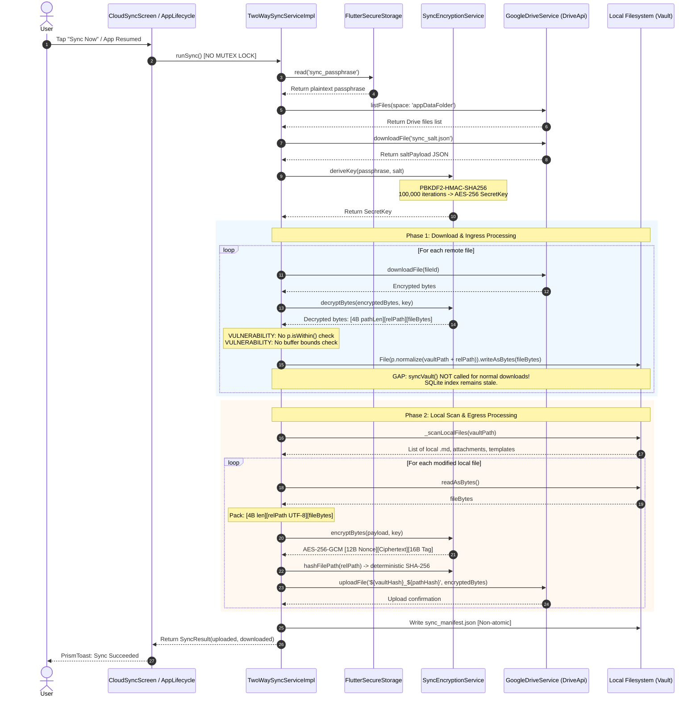
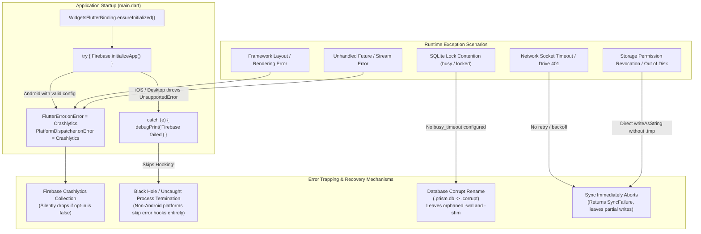

# Prism Architectural Audit: Security, Privacy, Cryptography & Resilience

**Auditor:** Subagent 4 — Cross-Cutting Concerns, Security & Resilience  
**Date:** October 2026  
**Target Repository:** `Prism` (Flutter / Dart / SQLite / Google Drive AppData)  
**Status:** Complete Audit Report  

---

## 1. Executive Summary

* **Strong Privacy Policy & Telemetry Opt-in Posture (ADR-0006 & ADR-0005):** Prism excels in regulatory privacy compliance. Native Android and iOS manifests suppress Firebase Analytics and Crashlytics at boot, runtime telemetry strictly defaults to opt-in with explicit onboarding confirmation, and in-editor wiretap pre-consent dialogs guard audio recording features against two-party wiretap liability.
* **Critical Cloud Sync Path Traversal & Truncation Vulnerabilities:** The E2EE Google Drive synchronization engine unpacks decrypted remote payloads (`relative_path` + binary data) directly into filesystem paths without validating directory boundary containment (`p.isWithin`). A maliciously crafted or corrupted cloud payload can escape the local vault root directory and overwrite arbitrary application databases or sandbox files. Additionally, missing buffer-length checks on binary headers cause unhandled runtime exceptions during malformed downloads.
* **Cryptographic & Key Management Fragility:** While AES-256-GCM and PBKDF2-HMAC-SHA256 (100,000 iterations) form a solid AEAD cryptographic baseline, the key management architecture suffers from severe flaws: changing passphrases in the UI overwrites local storage without re-encrypting cloud blobs (permanently bricking sync); `sync_salt.json` is stored globally without vault namespacing (causing multi-vault key collisions); deterministic unsalted SHA-256 relative path hashing leaks journaling patterns to Drive observers; and database encryption on mobile falls back to a hardcoded key (`'prism_db_fallback_key_2026'`) if keystore access hiccups.
* **Severe Local-First Security Discrepancy & Desktop Gap:** The Settings UI advertises "On-Device Storage Lock: Active (SQLCipher AES-256)", but this claim is deceptive: only the SQLite index is encrypted on mobile, while all Markdown notes, templates, and audio recordings remain unencrypted plaintext files on the filesystem. On desktop platforms (Windows, Linux, macOS), SQLCipher is completely bypassed and databases are unencrypted SQLite, yet the UI still claims active AES-256 encryption.
* **Fragile Error Handling, Concurrency & Lifecycle Disconnects:** Global error handling (`FlutterError.onError`, `PlatformDispatcher.onError`) is nested inside a conditional Firebase initialization block that throws and skips handler registration on iOS and desktop platforms. `TwoWaySyncService` lacks re-entrancy locks, HTTP request timeouts, and backoff retry logic. Furthermore, downloaded sync notes are written to disk without triggering database ingestion, leaving newly synced notes completely invisible in search, note lists, and graph views until the application is backgrounded and resumed.

---

## 2. Current Architecture Map

### 2.1 Security & Storage Boundary Diagram

The diagram below maps how sensitive user data, encryption keys, cryptographic salts, and raw Markdown files flow between user interaction, the local filesystem, platform secure enclaves, and external cloud services.

```mermaid
flowchart TD
    subgraph UI_Layer["UI & Presentation Layer"]
        Editor["Editor & Audio Recorder\n(Wiretap Consent Guarded)"]
        SecSettings["Security & Cloud Settings\n(Passphrase Management)"]
        DangerZone["Danger Zone Reset\n(DataDeletionService)"]
    end

    subgraph Memory_Layer["Volatile State & Enclave Layer"]
        RiverpodState["Riverpod State Container"]
        SecureStorage["FlutterSecureStorage\n(Android Keystore / iOS Keychain)\n- sync_passphrase (Plaintext)\n- prism_db_encryption_key (UUID)"]
        AnalyticsMem["AnalyticsService\n(Leaking Static Memory Buffers)"]
    end

    subgraph Local_Storage["Local Device Filesystem"]
        subgraph Vault_Sandbox["Active Vault Directory (.prism/)"]
            NotesMD["Plaintext Markdown Notes\n(*.md - NEVER encrypted)"]
            Attachments["Plaintext Audio Attachments\n(attachments/*.m4a)"]
            SidecarMeta[".prism-metadata.json\n(Atomic tmp->rename flush)"]
            SyncManifest[".prism/sync_manifest.json\n(Drive ID & Hash map)"]
            SQLiteDB[".prism.db & WAL\n(SQLCipher on Mobile / Plain SQLite on Desktop)"]
        end
    end

    subgraph External_Cloud["External Cloud Infrastructure"]
        subgraph Google_Drive["Google Drive (Hidden AppData Space)"]
            RemoteSalt["sync_salt.json\n(Global Plaintext Salt)"]
            CloudBlobs["vaultHash_pathHash Blobs\n(AES-256-GCM Encrypted)"]
        end
        subgraph Firebase_Cloud["Firebase Services"]
            FB_Analytics["Firebase Analytics\n(Strict Opt-In)"]
            FB_Crash["Firebase Crashlytics\n(Strict Opt-In)"]
        end
        subgraph RevenueCat_Cloud["RevenueCat"]
            RC_API["Subscriber API\n(Admin Secret Danger)"]
        end
    end

    Editor -->|Writes Plaintext| NotesMD
    Editor -->|Records Audio| Attachments
    SecSettings -->|Stores Raw Passphrase| SecureStorage
    SecSettings -->|Triggers Sync| CloudBlobs

    SecureStorage -.->|Key Derivation PBKDF2| SQLiteDB
    NotesMD -->|Ingestion / FTS5 Indexing| SQLiteDB
    SidecarMeta <-->|Sync Cache| SQLiteDB

    Vault_Sandbox <-->|TwoWaySyncEngine| CloudBlobs
    RiverpodState -->|Dispatches Events| AnalyticsMem
    AnalyticsMem -->|Gated by Consent| FB_Analytics
    AnalyticsMem -->|Gated by Consent| FB_Crash
    DangerZone -->|Wipes Keys| SecureStorage
    DangerZone -->|Deletes Local| Vault_Sandbox
    DangerZone -.->|Orphans Data (NO PURGE)| Google_Drive
    DangerZone -->|Attempts REST Delete| RC_API
```

---

### 2.2 End-to-End Cryptographic Sync Pipeline

Prism's E2EE synchronization pipeline encrypts note content and packs relative path metadata prior to transmission to Google Drive's hidden `appDataFolder`.



---

### 2.3 Error Handling & Lifecycle Resilience Architecture



---

## 3. Critical Flaws & Technical Debt

### 3.1 Vulnerabilities Ranked by Severity

| ID | Severity | Category | File Reference | Vulnerability / Failure Mode Description |
| :--- | :--- | :--- | :--- | :--- |
| **SEC-01** | **CRITICAL** | Security / Path Traversal | [`lib/core/services/two_way_sync_service.dart:L355-367`](file:///home/aadith/development/active-projects/Prism/lib/core/services/two_way_sync_service.dart#L355-L367) | **Arbitrary Path Traversal during Cloud Sync File Extraction:** Sliced `relPath` from decrypted cloud payloads is directly passed to `p.normalize(p.join(vaultPath, relPath))` without validating `p.isWithin(vaultPath, targetPath)`. A malicious payload containing `../../` can overwrite files outside the vault root. |
| **SEC-02** | **CRITICAL** | Resilience / Panic | [`lib/core/services/two_way_sync_service.dart:L355-357`](file:///home/aadith/development/active-projects/Prism/lib/core/services/two_way_sync_service.dart#L355-L357) | **Buffer Overread & RangeError Crash in Binary Stream Decoding:** Slicing `decryptedBytes.sublist(4, 4 + pathLen)` performs zero checks on `decryptedBytes.length`. Truncated or malformed cloud blobs crash the sync worker with unhandled `RangeError`. |
| **SEC-03** | **HIGH** | Cryptography / Key Mgmt | [`lib/core/database/database_helper.dart:L78-81`](file:///home/aadith/development/active-projects/Prism/lib/core/database/database_helper.dart#L78-L81) | **Hardcoded Cryptographic Fallback Key for SQLite Database:** If `FlutterSecureStorage` encounters transient keystore errors during password generation, the database key falls back to `'prism_db_fallback_key_2026'`. |
| **SEC-04** | **HIGH** | Integrity / Data Loss | [`lib/features/settings/presentation/screens/security_settings_screen.dart:L59-64`](file:///home/aadith/development/active-projects/Prism/lib/features/settings/presentation/screens/security_settings_screen.dart#L59-L64) | **Broken Passphrase Change Mechanism Bricks Cloud Sync:** Changing the passphrase in Settings merely overwrites `sync_passphrase` in `FlutterSecureStorage` without re-encrypting existing Drive files or rotating the salt, resulting in permanent `SyncEncryptionFailure`. |
| **SEC-05** | **HIGH** | Secrets Exposure | [`lib/core/services/data_deletion_service.dart:L129-138`](file:///home/aadith/development/active-projects/Prism/lib/core/services/data_deletion_service.dart#L129-L138) | **Administrative Secret Exposure in Client Build (`REVENUECAT_SECRET_KEY`):** Client-side code queries `const String.fromEnvironment('REVENUECAT_SECRET_KEY')` to execute REST subscriber deletions. Embedding backend administrative API secrets in client binaries exposes the entire customer base to reverse-engineering. |
| **SEC-06** | **HIGH** | Privacy / GDPR Art. 17 | [`lib/core/services/data_deletion_service.dart:L113-119`](file:///home/aadith/development/active-projects/Prism/lib/core/services/data_deletion_service.dart#L113-L119) | **Incomplete Factory Reset Leaves Orphaned Remote Cloud Data:** "Delete All Data & Reset" only executes `driveService.disconnect()`. It never calls `purgeAppDataFolder()` or `deleteVaultCloudData()`, permanently stranding encrypted user files on Google Drive. |
| **SEC-07** | **HIGH** | Cryptography / Multi-Vault | [`lib/core/services/two_way_sync_service.dart:L102-106`](file:///home/aadith/development/active-projects/Prism/lib/core/services/two_way_sync_service.dart#L102-L106) | **Global Un-namespaced Salt File Causes Multi-Vault Cryptographic Collision:** `sync_salt.json` is stored at the root of `appDataFolder` without vault prefixing. Configuring sync on a second vault overwrites or duplicates the salt, breaking key derivation for the first vault. |
| **SEC-08** | **HIGH** | Resilience / Error Trapping | [`lib/main.dart:L43-74`](file:///home/aadith/development/active-projects/Prism/lib/main.dart#L43-L74) | **Global Error Handlers Skipped on All Non-Android Platforms:** `FlutterError.onError` and `PlatformDispatcher.onError` are nested inside `Firebase.initializeApp()`. On iOS and desktop, `DefaultFirebaseOptions.currentPlatform` throws `UnsupportedError`, bypassing error trapping completely. |
| **SEC-09** | **MEDIUM** | AuthN / Session Drop | [`lib/core/services/google_drive_service.dart:L80-83`](file:///home/aadith/development/active-projects/Prism/lib/core/services/google_drive_service.dart#L80-L83) | **Unrefreshed OAuth Tokens in Custom HTTP Client:** `account.authHeaders` is captured as a static map at sign-in. After 60 minutes, the Google access token expires and all API calls fail with 401 Unauthorized because tokens are never refreshed. |
| **SEC-10** | **MEDIUM** | Security Misrepresentation | [`lib/features/settings/presentation/screens/security_settings_screen.dart:L227-245`](file:///home/aadith/development/active-projects/Prism/lib/features/settings/presentation/screens/security_settings_screen.dart#L227-L245) | **Deceptive On-Device Encryption Status & Desktop Plaintext SQLite:** The UI proclaims "On-Device Storage Lock: Active (SQLCipher AES-256)". In truth, all Markdown notes and audio recordings are plaintext on disk, and on desktop platforms SQLite is completely unencrypted. |
| **SEC-11** | **MEDIUM** | Concurrency / Race | [`lib/core/services/two_way_sync_service.dart:L186-205`](file:///home/aadith/development/active-projects/Prism/lib/core/services/two_way_sync_service.dart#L186-L205) | **Re-Entrant Sync Without Mutex Locking:** `runSync()` lacks an active sync lock. Concurrent invocations (e.g. manual trigger + lifecycle resume) race to download/upload the same files and corrupt `sync_manifest.json`. |
| **SEC-12** | **MEDIUM** | Cryptography / Privacy | [`lib/core/services/sync_encryption_service.dart:L114-123`](file:///home/aadith/development/active-projects/Prism/lib/core/services/sync_encryption_service.dart#L114-L123) | **Deterministic Unsalted Relative Path Hashing Leaks Note Metadata:** Cloud filenames are computed via `Sha256().hash(utf8.encode(relativePath))` with zero salt. Precomputed rainbow tables can identify common note paths (e.g. `journal/2026-10-22.md`, `README.md`). |
| **SEC-13** | **MEDIUM** | Database / Concurrency | [`lib/core/database/database_helper.dart:L119-125`](file:///home/aadith/development/active-projects/Prism/lib/core/database/database_helper.dart#L119-L125) | **Missing SQLite `busy_timeout` Pragma:** Neither Android nor FFI database open routines configure `PRAGMA busy_timeout`. Under concurrent read/write pressure, queries fail instantly with `SqliteException: database is locked`. |
| **SEC-14** | **MEDIUM** | Observability / Leak | [`lib/core/services/analytics_service.dart:L15-18`](file:///home/aadith/development/active-projects/Prism/lib/core/services/analytics_service.dart#L15-L18) | **Unbounded Static In-Memory Log Buffering in Production:** Static lists `loggedEvents` and `loggedErrors` accumulate every telemetry event and exception in RAM indefinitely across production app sessions without eviction or bounds. |
| **SEC-15** | **LOW** | Resilience / Corruption | [`lib/core/database/database_helper.dart:L147-155`](file:///home/aadith/development/active-projects/Prism/lib/core/database/database_helper.dart#L147-L155) | **Orphaned WAL/SHM Artifacts During Database Recovery:** SQLite recovery renames only `.prism.db` to `.prism.db.corrupt`, leaving `.prism.db-wal` and `.prism.db-shm` behind to contaminate the fresh replacement database. |
| **SEC-16** | **LOW** | Data Loss / Audio | [`lib/core/database/prism_metadata_store.dart:L99-129`](file:///home/aadith/development/active-projects/Prism/lib/core/database/prism_metadata_store.dart#L99-L129) | **Audio Bookmarks Excluded from `.prism-metadata.json` Sidecar:** SQLite corruption recovery restores virtual folders, note folders, and graph pins, but omits `audio_bookmarks`. User timestamp bookmarks and voice annotations are permanently wiped. |
| **SEC-17** | **LOW** | Filesystem / Non-Atomic | [`lib/features/notes/data/adapters/local_vault_storage.dart:L11-13`](file:///home/aadith/development/active-projects/Prism/lib/features/notes/data/adapters/local_vault_storage.dart#L11-L13) | **Non-Atomic Markdown Note Writes:** Note updates invoke `File(path).writeAsString(content)` directly without writing to a temporary file first and atomically renaming. Crashes or power loss mid-write leave truncated 0-byte notes. |
| **SEC-18** | **LOW** | Security / Symlinks | [`lib/core/services/two_way_sync_service.dart:L130-175`](file:///home/aadith/development/active-projects/Prism/lib/core/services/two_way_sync_service.dart#L130-L175) | **Unfiltered Symlink Traversal in Vault Scanning:** Directory listings do not set `followLinks: false`. Symlinks inside the vault pointing outside to system files will be read, encrypted, and uploaded to cloud sync. |

---

### 3.2 Deep-Dive Technical Debt Analysis

#### SEC-01 & SEC-02: Path Traversal and Binary Slicing Panic in Sync Engine
In [`lib/core/services/two_way_sync_service.dart:L355-367`](file:///home/aadith/development/active-projects/Prism/lib/core/services/two_way_sync_service.dart#L355-L367), when unpacking downloaded files:
```dart
// Decode: [4-byte path length] + [UTF-8 path] + [file content]
final pathLen = decryptedBytes.buffer.asByteData().getUint32(0, Endian.big);
final relPath = utf8.decode(decryptedBytes.sublist(4, 4 + pathLen));
final fileBytes = decryptedBytes.sublist(4 + pathLen);

// Write local file
final localFilePath = p.normalize(p.join(vaultPath, relPath));
final localFile = File(localFilePath);
final parentDir = localFile.parent;
if (!await parentDir.exists()) {
  await parentDir.create(recursive: true);
}
await localFile.writeAsBytes(fileBytes);
```
**Failure Mechanics:**
1. If `decryptedBytes.length < 4`, `getUint32(0)` throws an unhandled `RangeError`.
2. If `4 + pathLen > decryptedBytes.length`, `sublist(4, 4 + pathLen)` throws a `RangeError`.
3. If an attacker crafts a payload where `relPath` is `../../../../databases/.prism.db` or `../../../../shared_prefs/app.xml`, `p.normalize(p.join(vaultPath, relPath))` resolves outside the vault root. The file is written directly to the target location, bypassing the Android sandbox vault boundaries.
4. **Remediation:** Validate buffer lengths before slicing. Normalize and verify with `if (!p.isWithin(vaultPath, localFilePath)) throw SecurityException(...)`.

---

#### SEC-03: Hardcoded Cryptographic Fallback in DatabaseHelper
In [`lib/core/database/database_helper.dart:L78-81`](file:///home/aadith/development/active-projects/Prism/lib/core/database/database_helper.dart#L78-L81):
```dart
    const secureStorage = FlutterSecureStorage();
    const key = 'prism_db_encryption_key';
    try {
      String? password = await secureStorage.read(key: key);
      if (password == null) {
        password = const Uuid().v4();
        await secureStorage.write(key: key, value: password);
      }
      return password;
    } catch (e) {
      debugPrint('[DB] Error loading/generating secure storage database password: $e');
      return 'prism_db_fallback_key_2026';
    }
```
**Failure Mechanics:**
1. On OEM Android devices (e.g. Xiaomi MIUI / Samsung Knox) under cold boot or screen lock, `FlutterSecureStorage` frequently throws transient `KeyStoreException` or `CryptoFailedException`.
2. When this occurs on first launch, the database is keyed with `'prism_db_fallback_key_2026'`. Any third-party attacker with physical access or backup extraction knowing this string can decrypt the database.
3. When `FlutterSecureStorage` later recovers, `_getDbPassword()` generates a new UUID v4 and attempts to open the database. Decryption fails.
4. Line 146 catches the failure, diagnoses it as "Unreadable database", and renames `.prism.db` to `.prism.db.corrupt`, destroying the user's relational database and requiring a full re-index.
5. **Remediation:** Never use a hardcoded fallback string. If secure storage fails, re-throw a fatal `InitializationException` with a user-facing retry prompt instead of corrupting or dangerously keying user databases.

---

#### SEC-04: Passphrase Change Bricks Sync Engine
In [`lib/features/settings/presentation/screens/security_settings_screen.dart:L59-64`](file:///home/aadith/development/active-projects/Prism/lib/features/settings/presentation/screens/security_settings_screen.dart#L59-L64):
```dart
        onSave: (newPass) async {
          await ref.read(secureStorageProvider).write(
                key: 'sync_passphrase',
                value: newPass,
              );
        },
```
**Failure Mechanics:**
1. A user establishes sync with Passphrase $P_1$ and Salt $S$. Notes $N_1 \dots N_k$ are uploaded to Google Drive encrypted under $K_1 = \text{PBKDF2}(P_1, S)$.
2. User goes to Security Settings and changes their passphrase to $P_2$.
3. The dialog writes $P_2$ to `FlutterSecureStorage`. It does **not** touch Google Drive or re-encrypt local files.
4. On the next sync run, `runSync()` downloads $S$, derives $K_2 = \text{PBKDF2}(P_2, S)$, and attempts to decrypt remote blobs encrypted with $K_1$.
5. `_encryptionService.decryptBytes()` fails AEAD authentication tag verification, returning `Left(DecryptionFailure)`.
6. Sync aborts. If the user edits a local note, it uploads with $K_2$. The remote Drive folder now contains a permanent mismatch of blobs encrypted under $K_1$ and $K_2$, making recovery on any other device impossible.
7. **Remediation:** Passphrase change must execute an atomic re-keying migration: download all remote files, decrypt with $K_1$, generate new salt $S_2$, derive $K_2$, re-encrypt all files, upload new salt and files, or warn the user that changing passphrase requires wiping cloud data and performing a full initial push.

---

#### SEC-09: Unrefreshed OAuth Tokens in Custom HTTP Client
In [`lib/core/services/google_drive_service.dart:L36-48`](file:///home/aadith/development/active-projects/Prism/lib/core/services/google_drive_service.dart#L36-L48):
```dart
class GoogleAuthClient extends http.BaseClient {
  final Map<String, String> _headers;
  final http.Client _client;

  GoogleAuthClient(this._headers, {http.Client? client})
      : _client = client ?? http.Client();

  @override
  Future<http.StreamedResponse> send(http.BaseRequest request) {
    return _client.send(request..headers.addAll(_headers));
  }
}
```
And in line 79-83:
```dart
  Future<void> _initDriveApi(GoogleSignInAccount account) async {
    final headers = await account.authHeaders;
    final client = GoogleAuthClient(headers);
    _driveApi = drive.DriveApi(client);
  }
```
**Failure Mechanics:**
1. `account.authHeaders` returns a snapshot containing `Authorization: Bearer ya29...`. Google OAuth tokens have a hard lifetime of 3,600 seconds (1 hour).
2. `GoogleAuthClient` stores this map in the private `_headers` field.
3. Once 1 hour elapses, subsequent sync runs fail with `401 Unauthorized` / `GoogleDriveAuthenticationFailure`.
4. The user is forced to manually sign out and sign in again.
5. In [`pubspec.yaml:L69`](file:///home/aadith/development/active-projects/Prism/pubspec.yaml#L69), `extension_google_sign_in_as_googleapis_auth: ^2.0.1` is declared as a project dependency. That package exists precisely to provide `account.authenticatedClient()`, which automatically refreshes access tokens upon expiration. It was never imported in `google_drive_service.dart`.
6. **Remediation:** Remove the custom `GoogleAuthClient` and replace `_initDriveApi` with `final client = await account.authenticatedClient(); _driveApi = drive.DriveApi(client!);`.

---

## 4. Architectural Mismatches

### 4.1 Local-First Filesystem Simplicity vs. Cloud Indexing Lag
Prism's core architecture adheres to the UNIX philosophy: human-readable Markdown files on disk are the ultimate source of truth, while SQLite acts as an ephemeral query cache.
However, `TwoWaySyncService` exhibits an architectural mismatch during cloud file ingress:
* In [`lib/core/services/two_way_sync_service.dart:L366`](file:///home/aadith/development/active-projects/Prism/lib/core/services/two_way_sync_service.dart#L366) and [`L509`](file:///home/aadith/development/active-projects/Prism/lib/core/services/two_way_sync_service.dart#L509), newly downloaded notes and remotely modified notes are written to disk via `await localFile.writeAsBytes(fileBytes);`.
* **The mismatch:** `syncVault(vaultPath)` is **never invoked** for standard downloads or updates (it is only called within the `isLocalModified` conflict branch at `L456`).
* **The consequence:** When sync finishes successfully and displays a success toast ("3 downloaded"), the downloaded notes **do not appear** in `notesProvider`, cannot be found via FTS5 search, and do not appear in the graph view. The user must manually background and foreground the application to trigger `AppLifecycleState.resumed` in [`lib/main.dart:L168`](file:///home/aadith/development/active-projects/Prism/lib/main.dart#L168) before the notes become visible in the UI.

### 4.2 Security Gated Behind Commercial Subscription Flags
In [`lib/core/router/app_router.dart:L285`](file:///home/aadith/development/active-projects/Prism/lib/core/router/app_router.dart#L285):
```dart
      GoRoute(
        path: '/settings/security',
        redirect: (context, state) => AppConfig.enableSubscriptions ? null : '/settings',
```
* **The mismatch:** Encryption, passphrase management, and local database security are fundamental privacy features, not monetization add-ons. Gating `/settings/security` behind `AppConfig.enableSubscriptions` means free users are redirected away from the Security Trust Center.
* **The consequence:** Free users cannot inspect encryption parameters, cannot set an encryption passphrase for future sync, and cannot audit on-device security. Security should be decoupled from commercial billing features.

### 4.3 Peak Memory Exhaustion in Mobile Vault Export
In [`lib/core/services/vault_export_service.dart:L268-280`](file:///home/aadith/development/active-projects/Prism/lib/core/services/vault_export_service.dart#L268-L280):
```dart
    final fileEntries = <({String relPath, List<int> bytes})>[];
    for (final path in filePaths) {
      final bytes = await File(path).readAsBytes();
      final relPath = p.relative(path, from: vaultPath).replaceAll('\\', '/');
      fileEntries.add((relPath: relPath, bytes: bytes));
    }
    final zipBytes = await Isolate.run(() {
      final archive = Archive();
      for (final entry in fileEntries) { ... }
      return ZipEncoder().encode(archive);
    });
```
* **The mismatch:** The export service loads every Markdown note and every binary audio file in `attachments/` into RAM simultaneously. It then transfers this massive list to a spawned `Isolate`, which duplicates the memory structure during serialization, and produces another byte buffer for the compressed ZIP archive.
* **The consequence:** A user with 200MB of voice recordings will experience memory spikes exceeding 800MB–1GB, triggering immediate OS OOM (Out Of Memory) process termination on standard Android and iOS devices. Vault export must use streaming chunked compression directly to a file sink on disk.

---

## 5. Raw Questions for the Principal Architect

1. **What is the true threat model for "On-Device Storage Lock"?**  
   If the goal is zero-knowledge protection against device seizure or forensic extraction, why are Markdown files and audio attachments left completely plaintext in the filesystem while only `.prism.db` is encrypted? Does Prism plan to adopt encrypted container vaults (e.g. EncFS / gocryptfs / SQLCipher-backed blob storage), or should the UI be updated to clarify that only metadata indexing is locked?
2. **Why is `REVENUECAT_SECRET_KEY` referenced in client-side code?**  
   Embedding administrative API secret keys in client binaries is a catastrophic security anti-pattern. Can the team eliminate the client-side REST call in `DataDeletionService` in favor of a serverless Cloud Function proxy, or rely exclusively on `Purchases.logOut()` for client-initiated resets?
3. **How should multi-vault cloud sync behave?**  
   Currently, `sync_salt.json` is a single global file at the root of Google Drive `appDataFolder`. Should each vault possess its own prefixed salt (e.g. `${vaultHash}_sync_salt.json`), and should each vault have an independent passphrase, or is there a single global master passphrase for all user workspaces?
4. **How should passphrase rotation be handled?**  
   Allowing users to change their passphrase in the UI without re-encrypting existing Drive blobs guarantees sync failure and data locking. Should passphrase changes trigger a full cloud wipe and re-upload, an in-place cloud re-keying migration, or should passphrases be immutable once set?
5. **Why are global error handlers tied to Firebase initialization?**  
   If Firebase fails to initialize or is unconfigured (as on iOS, macOS, Windows, and Linux), all unhandled framework and async errors fall into a black hole with no local logging or telemetry. Shouldn't `PlatformDispatcher.onError` and `FlutterError.onError` be initialized unconditionally with a local file/console logger prior to Firebase setup?
